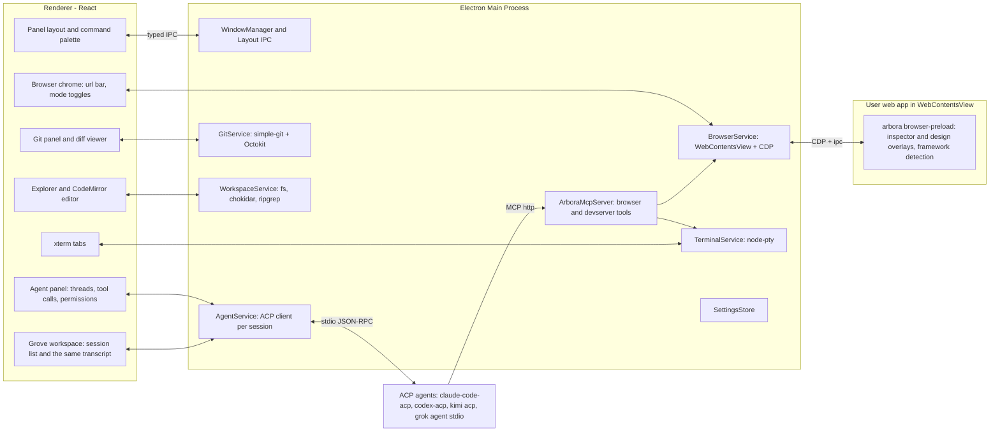

# Arbora: App Plan

Arbora is a cross-platform desktop app (Linux Arch/Debian, macOS, Windows) for building web apps by pointing at the running app instead of editing code. It is inspired by Cursor's design mode. The main panel is an embedded browser showing your dev server. A side panel hosts any ACP-compatible coding agent. Two modes act on the live page: agent mode (point at a component, describe a change) and design mode (visually edit, then hand the diff to the agent). A second workspace, Grove, replaces that layout with a manager for many ACP agents at once. The browser workspace stays the default.

The companion document [BUILD_STAGES.md](./BUILD_STAGES.md) breaks the build into stages with instructions, gotchas and a progress tracker. This file is the "what and why"; that file is the "how and when".

## Current phase

Live tracker: [BUILD_STAGES.md § Progress](./BUILD_STAGES.md#progress). Agents must update this section and that table at the end of every piece of work.

**Now:** Stages 0–2 are `Done` ([PR #2](https://github.com/maplepreneur/arbora/pull/2), [PR #4](https://github.com/maplepreneur/arbora/pull/4), [PR #7](https://github.com/maplepreneur/arbora/pull/7)). Stage 3, Agent panel (ACP), is `In progress` in [PR #10](https://github.com/maplepreneur/arbora/pull/10) (not merged; CI pending): `packages/acp-client`, `AgentService` with thread persistence and `session/load`, permission cards, client fs/terminal handlers, the agent panel UI and the ACP log viewer. 214 unit tests and 19 e2e pass locally on Omarchy/Hyprland. Manual matrix (29 Oct 2026): Kimi Code and Grok Build `ok` end to end; Claude Code and Codex `blocked` because neither CLI is logged in on this machine (their auth cards were verified instead).

**Next:** Watch CI on PR #10 and merge. Log in to Claude Code (`claude /login`) and Codex (`codex login`) on the Omarchy machine and fill their Appendix B cells, run the Omarchy per-stage checks with the agent panel open, then mark Stage 3 `Done` and start Stage 4 (Agent mode, `Mod+K`); the [Stage 4 Notes](./BUILD_STAGES.md#progress) list the hand-off. Stage 10 (Grove, the agent-manager workspace) is specified and waits on Stage 3; it is not next.

**Blockers / open:** Claude Code and Codex logins are missing on the test machine (user action). Open item carried over: the flaky macOS e2e clipboard step in the terminal tests (see the Stage 2 gotchas).
---

## 1. Product summary

| Area | Summary |
| --- | --- |
| Browser panel | Embedded Chromium showing the user's dev server. URL bar, navigation, viewport presets, screenshots, console/network capture, React/Vue DevTools. |
| Agent panel | Any ACP agent (Claude Code, Codex, Kimi Code, Grok Build, custom). Streaming messages, tool calls, diffs, permissions, plans, slash commands. Docked beside the browser. |
| Grove | A second workspace that takes the whole window: a list of ACP sessions and one transcript. Title-bar switch, hotkeys, a default agent, and a badge when an agent needs you. |
| Agent mode (`Mod+K`) | Inspector-style hover/click on components. Click opens a prompt popover. Submit sends prompt + component source + screenshot to the agent. |
| Browser control for agents | An MCP server exposing browser and dev-server tools (navigate, click, type, scroll, screenshot, snapshot, logs, restart) so the agent can verify its own work. |
| Design mode (`Mod+D`) | Webflow-like visual editing (text, spacing, layout, typography, colors, structure). Save sends before/after screenshots + change list + component sources to the agent. |
| Terminal panel | Tabs and splits, mostly for running dev servers. Detects dev-server URLs and opens them in the browser. |
| Git panel | Status, stage, hunks, commit, branches, log, push/pull, stash, GitHub PRs. Click a change to see a diff. |
| Files and editor | Explorer, quick open, ripgrep search, CodeMirror editor with highlighting and diagnostics. Zed-like lightness; hand editing is secondary. |

Design principles:

- The browser is the product. Everything else supports pointing at a thing and describing a change.
- Two workspaces, one window. The browser workspace is the default. Grove is the other full layout, for several agents at once. Switching parks the page and keeps agents running. Quitting the app stops them.
- Agents own their auth, models and tools. Arbora is a client, never a proxy for provider keys.
- One Chromium. No extra webviews, no language servers by default, no telemetry.
- Every stage ends with an app you can actually use.

---

## 2. Stack decision

**Electron + TypeScript + React. Not Tauri.**

The browser panel needs four things that only Electron gives consistently across all three OSes:

1. A full Chromium with identical rendering on Linux, macOS and Windows.
2. Chrome DevTools Protocol (CDP) access to the embedded page (`webContents.debugger`).
3. Loading DevTools extensions (React DevTools, Vue DevTools) via `session.loadExtension`.
4. Injecting a preload script into arbitrary user pages, plus programmatic screenshots (`capturePage`).

Tauri uses the OS webview (WebKitGTK on Linux, WKWebView on macOS, WebView2 on Windows). There is no unified CDP, no extension loading, and rendering differs per platform. Lightness is achieved through architecture (one Chromium, lazy panels, no LSP by default), not runtime choice. See [ADR 0001](#adr-0001-electron-over-tauri).

### Core libraries

| Concern | Choice | Notes |
| --- | --- | --- |
| Shell | Electron (latest stable), `electron-vite`, TypeScript strict | `contextIsolation: true`, `sandbox: true`, no `nodeIntegration` anywhere |
| Package manager | pnpm workspaces | Monorepo with `apps/` and `packages/` |
| Renderer | React 19, Tailwind CSS, Radix primitives, `react-resizable-panels`, Zustand, `cmdk` | Typed IPC validated with `zod` |
| Browser panel | `WebContentsView` (not `<webview>`), `webContents.debugger` (CDP), `session.loadExtension` | Persistent partition `persist:arbora-browser` |
| Agents | `@agentclientprotocol/sdk` v2.x, stable v1 default entrypoint, fluent `client({ name })` API | Agents spawned as stdio child processes |
| Browser control | MCP server with `@modelcontextprotocol/sdk`, Streamable HTTP on `127.0.0.1`, per-session bearer token | Registered via ACP `session/new` `mcpServers` |
| Terminal | `node-pty` + `@xterm/xterm` (+ fit, webgl, search addons) | |
| Git | `simple-git` over system `git`; Octokit + OAuth device flow (reuse `gh` auth when present) | |
| Editor | CodeMirror 6 (`@codemirror/lang-*`, `@codemirror/lint`, `@codemirror/merge`) | LSP via `@codemirror/lsp-client` opt-in only |
| Files | `chokidar` (watch), `@vscode/ripgrep` (search) | |
| Packaging | `electron-builder`: AppImage, `.deb`, AUR PKGBUILD (wrapping tarball), notarized `.dmg`, NSIS `.exe` | `electron-updater` + GitHub Releases |
| Testing | Vitest (unit), Playwright for Electron (e2e) against `fixtures/` apps | Fixtures: Vite+React, Next.js, Nuxt, plain HTML |
| Primary dev target | Arch Linux, Omarchy, Hyprland (Wayland) | Electron runs natively on Wayland via `ELECTRON_OZONE_PLATFORM_HINT=auto` (set by Omarchy) |

### Agent launch commands (verified Oct 2026, all stdio JSON-RPC)

| Agent | Command | Auth |
| --- | --- | --- |
| Claude Code | `npx -y @zed-industries/claude-code-acp` | Claude login or `ANTHROPIC_API_KEY` |
| Codex | `npx -y @agentclientprotocol/codex-acp` | ChatGPT login, `CODEX_API_KEY` or `OPENAI_API_KEY` |
| Kimi Code | `kimi acp` | Prior `kimi` login. Supports image prompts and http/sse/stdio MCP |
| Grok Build | `grok agent stdio` (or `npx @xai-official/grok agent stdio`) | `grok login` or `XAI_API_KEY`; auth method ids `xai.api_key` / `cached_token` |
| Custom | User-supplied `command`, `args`, `env` | Same shape as Zed's `agent_servers` |

---

## 3. Architecture



### Process model

- **Main process** owns all privileged services. Each service is a class with a zod-validated IPC surface. No business logic in IPC handlers; handlers call services.
- **Renderer** is a single React app. It never touches Node. It talks to main over `contextBridge` APIs defined in `packages/shared` (request/response and event subscriptions).
- **Browser preload** (`browser-preload.ts`) is injected into the user's page via the `WebContentsView` `webPreferences.preload`. It runs in an isolated world, exposes nothing to the page, and communicates with main over a private IPC channel. It hosts the inspector overlay, design overlay, framework detection and source resolution.
- **Agents** are child processes spawned by `AgentService`. Arbora is the ACP client. Each session also gets an MCP server URL for browser control.

### Key flows

**Agent mode prompt**

1. User presses `Mod+K`; main tells the browser preload to enable the inspector overlay.
2. Hover highlights elements with box model and component label (e.g. `Button <- CardHeader <- Card`).
3. Click freezes selection and opens a prompt popover (rendered by the renderer, anchored using element rect forwarded from preload).
4. On submit, `BrowserService` resolves component context (see 4.3), captures a screenshot with the element outlined, and the renderer composes an ACP prompt with text, image and resource_link blocks.
5. `AgentService.prompt(sessionId, blocks)` streams updates back to the agent panel.

**Agent verification loop**

1. Agent edits files (via its own tools or ACP `fs/write_text_file`).
2. The dev server hot-reloads.
3. Agent calls MCP tools `browser_screenshot`, `browser_snapshot`, `devserver_logs`, compares with the request, iterates.
4. Agent finishes with a summary and a final screenshot.

**Design mode save**

1. On `Mod+D`, preload takes a "before" screenshot and enables the design overlay.
2. Every edit is recorded as an op `{ target, kind, before, after }` and applied live to the DOM as inline styles / mutations. The dev server is untouched.
3. On Save, Arbora captures an "after" screenshot, renders the op list as a readable change list, attaches resolved component sources and the detected styling approach (Tailwind, CSS modules, styled-components, plain CSS), and sends it to the agent.
4. Discard reverts the DOM. Sessions are stored in `.arbora/design-sessions/` for re-send.

### Repository layout

```
arbora/
  apps/desktop/                 electron-vite app
    src/main/                   services, IPC registration, window management
    src/preload/                app preload (contextBridge) and browser-preload (injected into user pages)
    src/renderer/               React app
  packages/shared/              zod IPC schemas, domain types, feature-flag constants
  packages/acp-client/          agent registry, spawning, ACP session wrapper, update normalization
  packages/browser-bridge/      CDP helpers, overlay scripts, framework detection, source resolution
  packages/mcp-browser-server/  MCP tool definitions and server
  fixtures/                     sample apps for e2e: vite-react, next, nuxt, plain-html
  docs/                         PLAN.md, BUILD_STAGES.md
  AGENTS.md                     conventions for the builder agent
```

### Per-project data (`.arbora/` inside the user's project)

```
.arbora/
  project.json          dev command, dev URL, keybinding overrides, default agent, Grove open-default flag
  threads/              persisted agent threads (JSON)
  screenshots/          screenshots for agents that lack image prompt support
  design-sessions/      saved design-mode op lists + before/after screenshots
  SKILL.md              browser-control instructions for agents that read skills
```

`.arbora/` is added to `.gitignore` by Arbora on first run (with user consent), except `project.json`, which is meant to be committed.

### Security

- `contextIsolation`, `sandbox`, no `nodeIntegration`, CSP on the renderer, `setWindowOpenHandler` on every `webContents`.
- Browser preload runs in an isolated world; the user's page cannot call Arbora APIs.
- MCP server bound to `127.0.0.1`, random port, per-session bearer token, requests without a valid token are rejected.
- ACP `fs/*` handlers are path-scoped to the project root (resolve + prefix check, deny symlink escapes).
- Agent navigation off the dev-server origin requires a one-time allow.
- No remote code loading, no telemetry.

---

## 4. Feature specification

Feature IDs (`F-AREA-NN`) are referenced from [BUILD_STAGES.md](./BUILD_STAGES.md).

### 4.1 Shell and layout (`F-SHELL`)

- `F-SHELL-01` Open a project folder (dialog, recent projects, drag-and-drop). One window per project.
- `F-SHELL-02` Browser workspace layout: centre browser panel, right agent panel, bottom drawer (Terminal, Git, Problems), left activity rail (Files, Git, Search). Resizable, collapsible, persisted per project. Grove (`F-GROVE`) replaces this whole layout while it is active. The saved browser layout is restored on the way back.
- `F-SHELL-03` Command palette (`Mod+Shift+P`).
- `F-SHELL-04` Keybinding service with JSON settings and a settings UI. Defaults: `Mod+K` agent mode, `Mod+D` design mode, `Esc` exit mode, `Mod+P` quick open, `Mod+Shift+P` command palette, plus the Grove chords in `F-GROVE-02`.
- `F-SHELL-05` `Mod` = Cmd on macOS, Ctrl on Linux and Windows. Super is deliberately not used: Omarchy binds `Super+K` to its keybindings viewer, Windows binds `Win+K`/`Win+D`, and GNOME grabs many Super chords, all at a level the app cannot intercept. Mode chords and the Grove workspace chords must also work while the embedded browser has focus (intercepted in main via `before-input-event` before the page sees them). Plain `Ctrl` chords are passed through to the shell when a terminal is focused. Every binding is configurable.
- `F-SHELL-06` Dark/light theme, system fonts, no telemetry.

### 4.2 Browser panel (`F-BROWSER`)

- `F-BROWSER-01` URL bar, back/forward/reload, hard reload, open external, DevTools toggle, zoom.
- `F-BROWSER-02` Viewport presets (desktop/tablet/mobile widths, DPR) rendered by resizing the `WebContentsView` inside a letterboxed container.
- `F-BROWSER-03` Auto-detect dev-server URLs printed in terminals and offer "Open in browser".
- `F-BROWSER-04` Persistent session partition per project (logins survive restarts), with a "reset browser data" action.
- `F-BROWSER-05` CDP attached on load: console messages and network failures buffered and shown in the Problems tab.
- `F-BROWSER-06` Screenshot API: full viewport, element clip, optional highlight burn-in. PNG, returned as base64 and optionally written to `.arbora/screenshots/`.
- `F-BROWSER-07` Bundled unpacked React DevTools and Vue DevTools loaded into the browser partition (never read from the user's Chrome profile).
- `F-BROWSER-08` Browser preload bootstrap with a private IPC channel to main.

### 4.3 Agent mode (`F-INSPECT`)

- `F-INSPECT-01` Inspector overlay: hover highlight with box model, component label, breadcrumb to pick ancestors, `Esc` exits, `Mod+K` toggles.
- `F-INSPECT-02` Click opens an anchored prompt popover: multiline input, Enter submits, `Shift+Enter` newline, attachment chips (component source, screenshot, console errors), agent/session selector.
- `F-INSPECT-03` Framework detection in page: React (`__REACT_DEVTOOLS_GLOBAL_HOOK__.renderers` or `__reactFiber$*` keys on DOM nodes), Vue 3 (`__vue_app__`, `__vueParentComponent`), Next (`__NEXT_DATA__` / `next` global), Nuxt (`__NUXT__`), Svelte (`__svelte`), Angular (`ng`), fallback plain HTML.
- `F-INSPECT-04` Component source resolution tiers (best wins; tier reported in the prompt):
  1. Exact file:line from a build-time attribute (`data-arbora-src`, or compatible `code-inspector-plugin` / `data-source` attributes) when the optional `@arbora/dev-plugin` is installed (stretch).
  2. Framework internals: React fiber `_debugSource` (React <= 18) or `_debugOwner` / owner stacks (React 19) plus component `displayName`; Vue component `__file` and `name`.
  3. Component name chain + trimmed `outerHTML`, class list, text content, computed-style subset, bounding box. The agent greps the workspace by component name and class names.
- `F-INSPECT-05` Prompt payload: user text, framework and tier, resolved paths as ACP `resource_link` blocks, trimmed HTML, screenshot as ACP `image` block (PNG base64) with the element outlined, relevant console errors, and a standard instruction block asking the agent to verify using browser tools.
- `F-INSPECT-06` Fallback for agents without image prompt capability: write the screenshot to `.arbora/screenshots/` and reference the path.

### 4.4 Agent panel (`F-AGENT`)

- `F-AGENT-01` Agent registry: built-ins (Claude Code, Codex, Kimi Code, Grok Build) and custom entries; binary detection with install hints; per-agent env overrides.
- `F-AGENT-02` Session lifecycle: `initialize` (advertise `fs.readTextFile`, `fs.writeTextFile`, `terminal: true`), `authenticate` with the agent's advertised methods (device/browser logins surfaced in UI), `session/new` with project cwd and the Arbora MCP server, `session/load` / `session/resume` when supported, `session/cancel`.
- `F-AGENT-03` Mode and model pickers via `session/set_mode` / `session/set_model` when advertised.
- `F-AGENT-04` Streaming UI for `session/update`: message chunks (markdown), thoughts (collapsible), tool calls with status, locations and diffs, plan/todo lists, available commands (slash commands).
- `F-AGENT-05` Permission requests: allow once / always / reject, per-tool remembered choices.
- `F-AGENT-06` Client-side methods: `fs/read_text_file`, `fs/write_text_file` (project-scoped, feeding the Git panel's "Agent changes" group), `terminal/*` backed by `TerminalService` (visible as tabs), `session/request_permission`.
- `F-AGENT-07` Multiple threads per project, persisted locally, with titles and pinned context. The docked panel and Grove (`F-GROVE-07`) are two views of this same list. Creating or archiving a thread in either place updates the other. Each workspace remembers its own selected thread.
- `F-AGENT-08` ACP log viewer (raw JSON-RPC both directions) for debugging.
- `F-AGENT-09` Image and embedded-context prompt blocks when the agent's `promptCapabilities` allow; otherwise fall back per `F-INSPECT-06`.

### 4.5 Browser control for agents (`F-MCP`)

- `F-MCP-01` `ArboraMcpServer` in main, Streamable HTTP on `127.0.0.1:<random>`, per-session bearer token, registered in `session/new` `mcpServers` (http). A stdio shim command is provided for agents that only support stdio MCP.
- `F-MCP-02` Browser tools: `browser_navigate`, `browser_reload`, `browser_back`, `browser_screenshot` (viewport / full page / element by selector or ref), `browser_snapshot` (accessibility tree with element refs), `browser_click`, `browser_type`, `browser_press_key`, `browser_hover`, `browser_scroll`, `browser_select_option`, `browser_wait_for` (selector / text / network idle), `browser_evaluate` (sandboxed JS), `browser_console_logs`, `browser_network_errors`, `browser_get_element_source` (reuses `F-INSPECT-04`), `browser_set_viewport`.
- `F-MCP-03` Dev-server tools: `devserver_status`, `devserver_logs` (tail from the terminal ring buffer), `devserver_restart` (uses `.arbora/project.json` dev command), `terminal_run` (short-lived command with captured output and timeout).
- `F-MCP-04` Tool calls surface in the agent panel; navigation off the dev-server origin requires a one-time allow.
- `F-MCP-05` Agent instructions: Arbora injects an instruction block into the first prompt of each session and writes `.arbora/SKILL.md`, describing the loop: inspect -> edit -> wait for HMR -> screenshot -> compare -> finish with summary and final screenshot.

### 4.6 Design mode (`F-DESIGN`)

- `F-DESIGN-01` Selection model shared with the inspector overlay; multi-select with Shift.
- `F-DESIGN-02` Inline text editing (contenteditable on text nodes) with original text captured.
- `F-DESIGN-03` Properties panel (replaces agent panel while active): Layout (display, flex/grid, direction, align, justify, gap, wrap), Spacing (margin/padding with drag handles), Size, Position, Typography, Background and Borders (color, radius, border, shadow), Opacity/Visibility.
- `F-DESIGN-04` Tailwind mapper: when the project uses Tailwind, CSS edits are translated to suggested utility classes.
- `F-DESIGN-05` Structure ops: move within parent or into a sibling container (drag with drop indicators), duplicate, delete, insert basic element (div/text/image/button).
- `F-DESIGN-06` Undo/redo stack; live preview via inline styles and DOM mutation; the dev server is never touched during editing.
- `F-DESIGN-07` Change tracking as an ordered op list: `{ target: { componentChain, selector, source? }, kind: style | text | attr | move | insert | delete, before, after }`.
- `F-DESIGN-08` Save: before screenshot (taken at mode entry), after screenshot, human-readable change list, resolved component sources, detected styling approach, sent to the selected agent. Discard reverts the DOM.
- `F-DESIGN-09` Design sessions saved in `.arbora/design-sessions/` and re-sendable.
- `F-DESIGN-10` (Stretch) Direct write-through for exact-tier Tailwind class edits without an agent round trip.

### 4.7 Terminal panel (`F-TERM`)

- `F-TERM-01` Multiple tabs and splits, shell detection per OS (zsh/bash/fish, PowerShell), cwd = project, link detection, search, copy/paste, clear, kill.
- `F-TERM-02` Login-shell PATH on macOS and Linux GUI launches so `kimi`, `grok`, `node`, `pnpm` resolve.
- `F-TERM-03` "Run dev server" quick action from `.arbora/project.json`, with URL auto-open (`F-BROWSER-03`).
- `F-TERM-04` Output ring buffer per terminal (for `devserver_logs`).
- `F-TERM-05` Agent-created ACP terminals appear as read-only tabs with a badge.

### 4.8 Git panel (`F-GIT`)

- `F-GIT-01` Status with staged/unstaged/untracked groups, stage/unstage file and hunk, discard.
- `F-GIT-02` Commit, amend, agent-generated commit message on request.
- `F-GIT-03` Branch list/create/switch, log with graph, push/pull/fetch, stash, remotes.
- `F-GIT-04` Clicking a change opens the diff viewer (CodeMirror merge view, side-by-side or inline, word diff).
- `F-GIT-05` Explorer shows git status decorations.
- `F-GIT-06` GitHub: OAuth device flow or `gh` auth reuse; create PR (agent-drafted title/body on request), list PRs for the branch, open in browser, CI status badges.
- `F-GIT-07` "Agent changes" group: files written by agents (ACP `fs/write_text_file` plus watcher-detected changes during a turn) grouped for review.

### 4.9 File explorer and editor (`F-FILES`, `F-EDITOR`)

- `F-FILES-01` Tree with lazy loading, watcher, create/rename/delete, reveal in OS.
- `F-FILES-02` Quick open (`Mod+P`) with fuzzy search.
- `F-FILES-03` Project text search via ripgrep with include/exclude globs.
- `F-EDITOR-01` CodeMirror 6 editor: TS/JS/TSX/JSX/HTML/CSS/JSON/MD/Vue/Svelte/Python/Go/Rust, bracket matching, folding, multi-cursor, tabs, dirty indicators, image preview.
- `F-EDITOR-02` Format on save via the project's Prettier when present.
- `F-EDITOR-03` Diagnostics on save by running project ESLint / `tsc` (cheap, no daemon).
- `F-EDITOR-04` LSP (`@codemirror/lsp-client` + `typescript-language-server`) as an opt-in setting.

### 4.10 Onboarding and settings (`F-ONBOARD`)

- `F-ONBOARD-01` First-run: pick project, detect dev command from `package.json` scripts, detect installed agents, test-launch chosen agent, verify keybindings. The Grove step (pick a default agent, press the workspace chord once) is added by Stage 10, not by the first version of this wizard.
- `F-ONBOARD-02` Settings UI and JSON: agents, keybindings, theme, browser partition reset, MCP tool permissions, dev-server command, screenshot storage. The Grove section (`notify`, fallback agent) is added by Stage 10.

### 4.11 Non-functional (`F-NFR`)

- `F-NFR-01` Security requirements listed in section 3.
- `F-NFR-02` Performance targets: idle RSS under ~350 MB with the browser loaded, panel open under 100 ms, screenshot under 300 ms.
- `F-NFR-03` CI matrix (ubuntu, macos, windows): typecheck, lint, unit, e2e smoke, package artifacts on tags.
- `F-NFR-04` Signed and notarized builds, auto-update.

---

### 4.12 Grove (`F-GROVE`)

Grove is the other workspace. The browser workspace stays the one the app opens on: the page in the centre, one agent docked beside it, the terminal underneath. Grove takes that whole area and turns it into a manager for many ACP agents in the same project. The name is the workspace, the command category, and the sidebar heading. A grove is a tended group of trees; this view is the group of agents working the project the browser is shaping.

It is inspired by [Solo](https://soloterm.com/) and [Herdr](https://herdr.dev/). Both are places where several coding agents sit in a sidebar, each with a live status, and you jump into the one that needs you. Grove takes that job and keeps Arbora's ACP client (ADR 0002, ADR 0004). The main pane is the structured transcript from Stage 3 (messages, thoughts, tool calls, diffs, plans, permissions), not a copy of the agent's terminal UI. Solo's and Herdr's PTY attach, SSH machines, and "agents keep running after the app quits" are out of scope. Agents are child processes of Arbora. Switching to the browser leaves them running. Quitting Arbora stops them. The empty state says so.

- `F-GROVE-01` Title-bar switch. Grove replaces the browser layout; the page is parked, not reloaded.
- `F-GROVE-02` Hotkeys, including chords that only apply inside Grove.
- `F-GROVE-03` Session list: status, order, rename, stop, restart, archive, Recent.
- `F-GROVE-04` Default agent, and opening it when Grove is empty.
- `F-GROVE-05` Main pane: the shared transcript, a pinned permission card, the composer.
- `F-GROVE-06` Attention: badge, desktop notification, jump to the session that needs you.
- `F-GROVE-07` One thread list shared with the docked agent panel. Each workspace keeps its own selection.
- `F-GROVE-08` Narrow window: the list collapses to a rail.
- `F-GROVE-09` What a switch does to agent mode, design mode, terminals and the page.

#### Layout

The switch sits in the title bar, in the right-hand cluster, immediately left of the Commands button. It is a two-segment control, the same height as that button (`h-6`), `app-no-drag`, with a border and a 4px gap from Commands.

```
┌──────────────────────────────────────────────────────────────────────────┐
│ ● Arbora / vite-react          [ Browser | Grove 2 ]  Commands   theme  │
└──────────────────────────────────────────────────────────────────────────┘
```

- Left segment: lucide `AppWindow`, label "Browser", `data-testid="workspace-browser"`.
- Right segment: lucide `Trees`, label "Grove", `data-testid="workspace-grove"`.
- The active segment uses `bg-accent-soft` and `text-accent`, and `aria-pressed="true"`. The inactive segment is `text-fg-muted`.
- Each segment's tooltip includes its chord (`Mod+1`, `Mod+2`). The toggle chord (`Mod+Alt+G`) is on the group.
- A count chip on the Grove segment (`data-testid="grove-attention-badge"`) shows how many sessions need attention. It uses `--attention` / `--attention-soft` (light `#9a6700` / `#fbf1d4`, dark `#e3b341` / `#2a220c`), registered as `attention` and `attention-soft` Tailwind colours. The chip is hidden at 0 and reads `9+` above 9. It is visible in both workspaces.
- Under a 640px-wide window the labels hide and the icons stay. The project name truncates (`min-w-0 truncate`) before the switch is clipped. The switch does not shrink.
- With no project open, both segments are disabled. A click or chord toasts "Open a project first."

Activating Grove unmounts the browser workspace (activity rail, sidebar, browser chrome, docked agent, bottom drawer) and mounts Grove in the content area under the title bar. Activating Browser does the reverse. This is a layout switch, not a panel collapse. The browser `WebContentsView` is parked (`setVisible(false)` and bounds `0,0,0,0`), not destroyed and not reloaded. Coming back applies the last rect the renderer sent. Terminal pty sessions and their xterm instances stay alive; the terminal panel already reattaches on mount. ACP processes stay alive.

```
┌─────────────────┬────────────────────────────────────────────────────────┐
│ Grove        [+]│  Claude Code          Working          opus · edit   ⋯ │
│                 │────────────────────────────────────────────────────────│
│ ● Claude Code   │                                                        │
│   Working       │   transcript (the Stage 3 components)                  │
│   fix the nav   │                                                        │
│ ○ Codex         │────────────────────────────────────────────────────────│
│   Needs you     │  Allow edit to src/App.tsx?    Once  Always  Reject    │
│   permission    │────────────────────────────────────────────────────────│
│ ○ Grok          │  Ask Claude Code…                               Send   │
│   Idle          │                                                        │
│                 │                                                        │
│ Default         │                                                        │
│ Claude Code     │                                                        │
│ ☑ Open when     │                                                        │
│   Grove is empty│                                                        │
└─────────────────┴────────────────────────────────────────────────────────┘
```

The session list is a `react-resizable-panels` group id `grove` (list id `grove-list`, main id `grove-main`), default list size 240px worth of the row, minimum 180px, maximum 420px. Sizes persist the same way as the browser layout. `Mod+B` in Grove toggles this list and does not change the files sidebar's saved state. Under 520px of content width the list forces a 44px rail of status dots and tooltips, and that forced size is not written back. A wide window restores the saved size. The browser layout's 764px minimum does not apply here.

The list header is the word "Grove" and one split button. The main click matches **New Agent** (the default agent, or the picker when none is set). The chevron matches **New Agent…** and lists detected agents plus "Choose agent…". A row is two lines, about 44px: an 8px status dot, the display name, and a subline (the permission title, the first line of the last assistant message, or the status word).

The main pane header is one row: display name, status word, model and mode pickers (`F-AGENT-03`), overflow menu. A pending permission card is pinned between the transcript and the composer, not only inside the scrollback. The composer placeholder is `Ask {name}…`. Selecting a session focuses the composer.

#### How a session looks

Status is derived from the ACP session, not from terminal output.

| Status | When | Dot |
| --- | --- | --- |
| Starting | Process spawned; `initialize` / auth / `session/new` not finished | Muted, pulsing |
| Working | A prompt turn is in flight and nothing is waiting on the user | Accent, pulsing |
| Needs you | Auth is unfinished, or a permission request has no response | Attention |
| Idle | Session is alive, no turn in flight, nothing unread | Muted, solid |
| Finished | The turn ended (any `stopReason` except `cancelled`) after this session was last looked at | Accent, solid |
| Failed | Spawn failed, or the process exited because it crashed | Danger |
| Stopped | The user stopped it, or it exited because the user stopped it | Empty ring |

A cancelled turn does not become Finished. Finished clears when that session is the selected one and the window is focused on it (Grove, or the docked panel showing that same thread). Sort the list: Needs you and Failed first (oldest wait first), then Starting and Working (newest update first), then Finished, Idle, Stopped. Several sessions may use the same agent. The display name is the agent name, with ` 2`, ` 3` by creation order when another live session already has it. Rename replaces that title and is the thread title from `F-AGENT-07`.

Row menu: Set as default agent, Rename, Restart, Stop, Archive. Stop keeps the row and can Restart (Stage 3's load/resume rules). Archive asks "Stop {name} and remove it from Grove? The transcript stays in Recent." when a turn is in flight or the process is alive, and "Remove {name} from Grove?" otherwise. Recent, under the list, shows the last five archived titles. Opening one calls `session/load` when the agent advertises it; otherwise the saved transcript is shown and **Continue** starts a new session of the same agent without resending the old transcript as a prompt.

The attention count is Needs you + Failed + unread Finished. A desktop notification fires on the transition into one of those, unless that session is already the visible focused one. Title and body: "{name}: waiting for permission" (or the permission title), "{name} finished" plus the first line of the last assistant message, or "{name} failed" plus the exit reason. Clicking it focuses the window, switches to Grove, and selects that session. `settings.grove.notify` (default `true`) turns notifications off. The badge stays either way. Nothing notifies for Starting or Working.

#### Default agent

`defaultAgent` in `.arbora/project.json` is the registry id. It already exists in the schema; Grove is the UI that sets it. The project value wins, then `settings.grove.fallbackAgent` (this machine only, for a repo that does not commit a default), then none. An id that is not in the registry is treated as none, with the same warning path as a bad `project.json`.

The sidebar footer shows "Default", the resolved name or "Not set", **Change**, and a checkbox "Open when Grove is empty" (`startDefaultOnOpen`, default `true`, stored in `project.json`). The checkbox is disabled until a default exists.

Opening Grove starts one session of the default agent only when all of these are true: the project has no live sessions, a default id is set, that agent is detected, `startDefaultOnOpen` is true, and this visit has not already tried. Toggling Browser → Grove → Browser does not start another. A failed start does not retry on its own; the pane shows the Stage 3 install or login hint and **Retry**. The "already tried" flag resets when leaving Grove.

When that auto-start does not run and nothing is live, the pane is centred copy: "No agent running." If a default is set but auto-start is off, the primary button is "Start {name}" and the secondary is "Choose an agent". If no default is set, the primary button is "Choose an agent". Under the buttons: "Agents keep running while you switch back to the browser. Quitting Arbora stops them."

**Change** and **Set as default agent** write the project `defaultAgent`. They do not spawn a session.

#### Hotkeys

All of these are `intercept: true` and configurable. `when: 'grove'` chords match only while Grove is the workspace, so the same keys still reach the page in the browser workspace. Main's interceptor has to receive the current workspace whenever it changes, the same way it receives the current mode, and it has to use the same `match()` as the renderer.

| Command | Id | Default | When |
| --- | --- | --- | --- |
| Show Browser | `arbora.showBrowserWorkspace` | `mod+1` | always |
| Show Grove | `arbora.showGrove` | `mod+2` | always |
| Toggle Browser / Grove | `arbora.toggleWorkspace` | `mod+alt+g` | always |
| New Agent | `arbora.grove.newDefault` | `mod+alt+n` | grove |
| New Agent… | `arbora.grove.newPicker` | `mod+alt+shift+n` | grove |
| Next Agent | `arbora.grove.nextSession` | `mod+alt+down` | grove |
| Previous Agent | `arbora.grove.previousSession` | `mod+alt+up` | grove |
| Show Agent That Needs You | `arbora.grove.showAttention` | `mod+alt+2` | always |
| Archive Agent | `arbora.grove.archiveSession` | `mod+alt+w` | grove |
| Set Default Agent | `arbora.grove.setDefaultAgent` | none | grove |

`Mod+1` shows the browser workspace and restores its last selection. `Mod+2` shows Grove and restores its last selected session. Neither chord jumps to whoever needs you. **Show Agent That Needs You** and the badge click do that: switch to Grove and select the oldest Needs you session, else the oldest Failed, else the oldest unread Finished. If none, toast "No agent needs you."

`Mod+K` or `Mod+D` while Grove is showing switches to the browser workspace and then enters that mode. Entering Grove while agent mode is on exits it. Entering Grove during design mode with an unsaved op list asks "Discard design edits and open Grove?" with Stay and Discard. Stay does nothing. Discard reverts the DOM (`F-DESIGN-08`) and then switches. An empty design session exits without asking.

`Mod+1` and `Mod+2` are plain `Ctrl` chords on Linux and Windows. While a terminal is focused they follow terminal passthrough and do not switch workspace; click the title-bar control or press `Mod+Alt+G`, which is not a plain `Ctrl` chord. Do not bind the toggle to `Mod+\`. On Linux that key is `Ctrl+\` (SIGQUIT) and, with Shift, the key event's character is `|` rather than `\`, so the binding would not match.

#### Persistence

Per project, in the machine-local project state (not committed): `workspace` (`browser` or `grove`, default `browser`), the `grove` panel-group sizes, and `grove.selectedThreadId`. Per project, committed in `project.json`: `defaultAgent`, `startDefaultOnOpen` (default `true`). Per machine, in `settings.json`: `grove.notify` (default `true`), `grove.fallbackAgent` (optional). Adding `grove` to app settings bumps `SETTINGS_VERSION` to 3 with a migration that only advances the version. `startDefaultOnOpen` is a defaulted field on the existing project schema and does not bump `PROJECT_SETTINGS_VERSION`.

#### Out of scope

- A terminal-UI clone of the agent. ACP terminals still appear as Stage 3 read-only tabs when the browser workspace is showing.
- A background daemon so agents survive quit.
- SSH, a herd across machines, or more than one project in the window.
- An agent spawning other agents. That is a Stage 11 stretch item, and it would be another MCP tool on top of Grove, not a PTY API.
- Dev servers inside the Grove sidebar. They stay in the terminal panel. Grove does not show a command runner.

---

## 5. Phase overview

Detailed instructions, gotchas and progress live in [BUILD_STAGES.md](./BUILD_STAGES.md).

| Stage | Name | Outcome |
| --- | --- | --- |
| 0 | Foundation | Monorepo, Electron shell, IPC layer, layout skeleton, keybindings, CI, unsigned builds |
| 1 | Browser panel | Load a dev server, CDP capture, screenshots, DevTools extensions |
| 2 | Terminal panel | Run dev servers, URL detection, ring buffer |
| 3 | Agent panel (ACP) | Talk to Claude Code, Codex, Kimi Code, Grok Build |
| 4 | Agent mode (`Mod+K`) | Point at a component, prompt the agent with source + screenshot |
| 5 | Browser control MCP server | Agent drives the browser to verify its work |
| 6 | Design mode (`Mod+D`) | Visual editing, save to agent with before/after and change list |
| 7 | Files and editor | Explorer, quick open, search, CodeMirror, diagnostics, diff viewer |
| 8 | Git and GitHub | Full git workflow and PRs |
| 9 | Distribution and polish | Signing, installers, updater, onboarding, settings |
| 10 | Grove | Second workspace: many ACP agents, title-bar switch, default agent, attention |
| 11 | Stretch | Dev plugin for exact source mapping, tabs, worktrees, write-through, Grove orchestration |

---

## 6. Architecture decision records

### ADR 0001: Electron over Tauri

**Context.** The product is an embedded browser with deep instrumentation (CDP, extension loading, preload injection, screenshots) that must behave identically on Arch, Debian, macOS and Windows.

**Decision.** Electron.

**Consequences.** Larger install (~100 MB more than Tauri) and higher baseline RSS. In exchange: one rendering engine, first-party CDP transport, DevTools extension support, mature packaging for all three OSes, one language (TypeScript) for the whole codebase. Lightness is pursued through lazy panel loading, no LSP by default, and a memory budget enforced in CI.

**Rejected.** Tauri (OS webviews, no unified CDP, WebKitGTK quirks on Linux). Native per-platform shells (triple the work). A web app + local daemon (loses OS integration and embedded-browser control).

### ADR 0002: ACP for agents

**Context.** Users want to bring their own agent. Claude Code, Codex, Kimi Code and Grok Build already ship ACP servers or official adapters, and Zed/JetBrains have proven the client side.

**Decision.** Arbora is an ACP client only. No bespoke provider integrations, no API keys stored in Arbora.

**Consequences.** Feature parity depends on each agent's advertised capabilities (image prompts, MCP transports, session load/resume). Arbora must degrade gracefully (text-only fallbacks, screenshot paths) and show capability gaps in the UI. Agents handle auth, billing and model choice.

### ADR 0003: MCP for browser control

**Context.** The agent needs to click, scroll, navigate and screenshot the embedded browser. ACP has no browser-control methods, but every target agent supports client-provided MCP servers.

**Decision.** Expose browser and dev-server tools via an MCP server hosted by Arbora's main process, registered per session through ACP `session/new` `mcpServers`.

**Consequences.** Tools are discoverable and permissioned through each agent's native MCP handling. Arbora provides http (Streamable HTTP) by default and a stdio shim for agents that only forward stdio MCP. A skill/instruction block teaches the agent the verify loop.

### ADR 0004: Grove is a second workspace over the ACP client

**Context.** Solo and Herdr manage a group of coding agents: a sidebar, a live status per agent, a way to jump to the one that is blocked, and a default tool so "new" does not ask every time. Both do it by owning the agent's real terminal. Arbora already decided to be an ACP client (ADR 0002) and to keep the browser as the product. Users still want that group view without giving up the page.

**Decision.** Grove is a workspace, switched from the title bar, that lists ACP sessions and shows one transcript. It reuses `AgentService` and the Stage 3 transcript. It does not embed agent TUIs, does not add a process supervisor that outlives the app, and does not replace the docked agent panel. The browser workspace remains the default.

**Consequences.** Status, permissions and "needs you" come from ACP events, so they are exact when the agent speaks ACP and useless for a CLI that does not. An agent keeps running across a workspace switch and dies when Arbora quits; the empty state says that. Session UI has to be built once and mounted in both places. A later orchestration tool (Stage 11) can start Grove sessions through MCP; it is not part of this workspace.

**Rejected.** Docking a second agent list inside the browser workspace (it fights the page). Replacing the docked panel with Grove (agent mode and design mode need an agent beside the page). Wrapping each agent in a PTY the way Solo and Herdr do (duplicates the terminal panel and drops diffs, plans and permission cards). A Herdr-style background server (a second product, and a second thing that must be trusted with the project).

---

## 7. Assumptions

- Electron over Tauri; TypeScript end to end, no Rust.
- Mode chords are `Mod+K` / `Mod+D` with `Mod` = Cmd on macOS and Ctrl on Linux and Windows, fully configurable. Super is avoided because compositors and OSes claim it first.
- The primary development and test machine is Arch Linux running Omarchy (Hyprland, Wayland). Every stage is verified there locally before it is considered done; macOS and Windows are verified in CI and on hardware when available.
- Agents own their auth; Arbora only passes optional env overrides.
- Grove is an ACP session manager in a second workspace. It does not embed agent TUIs, and agents do not keep running after Arbora quits.
- Design-mode edits go through the agent first; direct write-through is a stretch item.
- "Linting" means surfacing the project's own ESLint/tsc output; LSP is opt-in.
- Fixture apps in `fixtures/` are the acceptance baseline for every stage; they stay green.
