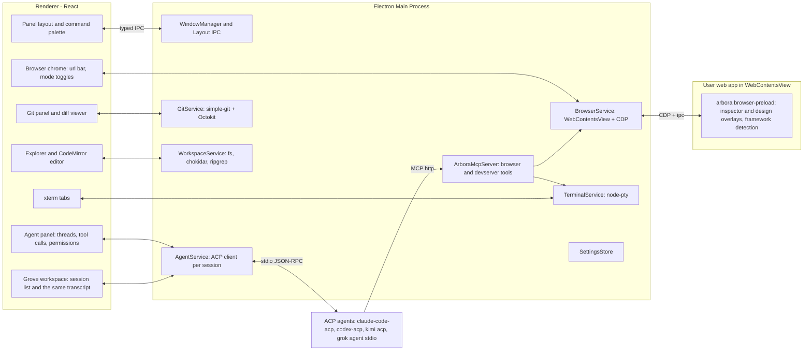

# Arbora: App Plan

Arbora is a cross-platform desktop app (Linux Arch/Debian, macOS, Windows) for building web apps by pointing at the running app instead of editing code. It is inspired by Cursor's design mode. The main panel is an embedded browser showing your dev server. A side panel hosts any ACP-compatible coding agent. Two modes act on the live page: agent mode (point at a component, describe a change) and design mode (visually edit, then hand the diff to the agent). A second workspace, Grove, replaces that layout with a manager for many ACP agents at once. The browser workspace stays the default.

The companion document [BUILD_STAGES.md](./BUILD_STAGES.md) breaks the build into stages with instructions, gotchas and a progress tracker. This file is the "what and why"; that file is the "how and when".

## Current phase

Live tracker: [BUILD_STAGES.md § Progress](./BUILD_STAGES.md#progress). Agents must update this section and that table at the end of every piece of work.

**Now:** Stages 0–8 are `Done`. Stage 6 was signed off on 30 Oct 2026. Stages 7 and 8 got `arch-ok` on Omarchy/Hyprland on 1 Nov 2026 (Hyprland 0.56.2): native Wayland, float and tile, DP-5 scale 1.25 restored afterward, `Ctrl+P` and `Ctrl+Shift+P`, the portal Open Project dialog, the packaged binary, and a workspace move. Stage 8's scratch pull request is [PR #1](https://github.com/maplepreneur/arbora-stage8-scratch/pull/1) on private `maplepreneur/arbora-stage8-scratch`. Stage 9 (Distribution and polish) is `In progress` on `main` (1 Nov 2026): the onboarding wizard, the full Settings UI (custom agents, env overrides, adapter versions, a shortcut editor with conflict detection, notifications and sounds, project and MCP permissions, updates and diagnostics), `electron-updater` with Stable and Beta channels, signing and notarization config, the AUR package and its release script, `release.yml` from tags, diagnostics export, an accessibility pass and user docs. It also adds the Projects page with project groups and **Switch Project…** (`F-SHELL-07`), agent groups and pinned threads (`F-AGENT-12`), and the title-bar bell, desktop notifications, sounds and badge when an agent needs you (`F-AGENT-13`). 495 unit tests and 43 e2e tests pass locally, and `main` CI is green on Linux ([run 41330724185](https://github.com/maplepreneur/arbora/actions/runs/41330724185)). Shipping is commits on `main` with no pull requests until GitHub Actions minutes are back ([AGENTS.md](../AGENTS.md#shipping)).

**Next:** finish Stage 9: decide on the idle-memory budget, cut a signed release from a tag once minutes and certificates exist, check fresh installs per OS, and `arch-ok` on Omarchy/Hyprland. Then Stage 10 (Grove), which can reuse Stage 9's attention state, agent groups, Settings page and onboarding wizard. Stages 12, 13 (Themes) and 14 (Extensions) are specified and not started.

**Blockers / open:** Stage 9's idle-memory budget fails (about 394 MB PSS against 350 with the bundled React and Vue DevTools, about 356 MB without them): load the DevTools extensions on demand, trim the renderer, or raise the budget. No signed release exists: tagging runs about 60 billed minutes, and the Apple and Windows certificates and the AUR key are not in the repo secrets yet. Fresh-install checks per OS are not done. Stage 6's Appendix B design-save row is still empty. Stage 5's manual matrix used free OpenCode models only, so Kimi Code and Grok Build have no Stage 5 runs. Claude Code and Codex stay built-in but are not tested. Still open from Stage 2: the flaky macOS e2e clipboard step in the terminal tests. Agent mode's target picker is not filtered by sign-in yet. The Stage 8 scratch repo cannot be deleted with the current `gh` token.

---

## 1. Product summary

| Area | Summary |
| --- | --- |
| Browser panel | Embedded Chromium showing the user's dev server. URL bar, navigation, viewport presets, screenshots, console/network capture, React/Vue DevTools. |
| Agent panel | Any ACP agent (Claude Code, Codex, Kimi Code, Grok Build, OpenCode, custom). Streaming messages, tool calls, diffs, permissions, plans, slash commands. Docked beside the browser. |
| Grove | A second workspace that takes the whole window: a list of ACP sessions and one transcript. Title-bar switch, hotkeys, a default agent, and a badge when an agent needs you. |
| Agent mode (`Mod+K`) | Inspector-style hover/click on components. Click opens a prompt popover. Submit sends prompt + component source + screenshot to the agent. |
| Browser control for agents | An MCP server exposing browser and dev-server tools (navigate, click, type, scroll, screenshot, snapshot, logs, restart) so the agent can verify its own work. |
| Design mode (`Mod+D`) | Webflow-like visual editing (text, spacing, layout, typography, colors, structure). Save sends before/after screenshots + change list + component sources to the agent. |
| Terminal panel | Tabs and splits, mostly for running dev servers. Detects dev-server URLs and opens them in the browser. |
| Git panel | Status, stage, hunks, commit, branches, log, push/pull, stash, GitHub PRs. Click a change to see a diff. |
| Files and editor | Explorer, quick open, ripgrep search, CodeMirror editor with highlighting and diagnostics. Zed-like lightness; hand editing is secondary. |
| Browser tabs | Several tabs per project: one **app tab** (the dev server) and any number of **reference tabs** (a Figma file, docs, the production site). A good-enough everyday browser, so you do not alt-tab to Chrome to log in or look something up. |
| Cross-tab agent work | Prompt from any tab and send it to a chosen project and thread. "Implement this design" from a Figma tab gives the agent read access to that tab. It studies the design, edits the project, screenshots the app tab and compares the two until they match. |
| Passwords (1Password) | The 1Password extension (or the `op` CLI as a fallback) fills and saves logins in every tab. A setup script installs and connects 1Password. Agents can ask Arbora to log in to a site but never see a password. |
| Themes | Light, dark and system stay. A `theme.json` can override the app's colour variables. Fonts and layout stay as they are. |
| Extensions | Settings installs from a short approved catalog. Browser entries are Svelte DevTools and Bitwarden. Coding entries are linters and tools, starting with Robocop. |

Design principles:

- The browser is the product. Everything else supports pointing at a thing and describing a change.
- Two workspaces, one window. The browser workspace is the default. Grove is the other full layout, for several agents at once. Switching parks the page and keeps agents running. Quitting the app stops them.
- Agents own their auth, models and tools. Arbora is a client, never a proxy for provider keys.
- Secrets stay with the user. Passwords, one-time codes and vault contents never enter a prompt, a tool result, a log or a screenshot sent to an agent. Agents can ask Arbora to log in; they cannot read what was filled.
- One Chromium. No extra webviews, no language servers by default, no telemetry.
- Every stage ends with an app you can actually use.

---

## 2. Stack decision

**Electron + TypeScript + React. Not Tauri.**

The browser panel needs four things that only Electron gives consistently across all three OSes:

1. A full Chromium with identical rendering on Linux, macOS and Windows.
2. Chrome DevTools Protocol (CDP) access to the embedded page (`webContents.debugger`).
3. Loading DevTools extensions (React DevTools, Vue DevTools) via `session.loadExtension`.
4. Injecting a preload script into arbitrary user pages, plus programmatic screenshots (`capturePage`).

Tauri uses the OS webview (WebKitGTK on Linux, WKWebView on macOS, WebView2 on Windows). There is no unified CDP, no extension loading, and rendering differs per platform. Lightness is achieved through architecture (one Chromium, lazy panels, no LSP by default), not runtime choice. See [ADR 0001](#adr-0001-electron-over-tauri).

### Core libraries

| Concern | Choice | Notes |
| --- | --- | --- |
| Shell | Electron (latest stable), `electron-vite`, TypeScript strict | `contextIsolation: true`, `sandbox: true`, no `nodeIntegration` anywhere |
| Package manager | pnpm workspaces | Monorepo with `apps/` and `packages/` |
| Renderer | React 19, Tailwind CSS, Radix primitives, `react-resizable-panels`, Zustand, `cmdk` | Typed IPC validated with `zod` |
| Browser panel | `WebContentsView` (not `<webview>`), `webContents.debugger` (CDP), `session.loadExtension` | Persistent partition `persist:arbora-browser` |
| Agents | `@agentclientprotocol/sdk` v2.x, stable v1 default entrypoint, fluent `client({ name })` API | Agents spawned as stdio child processes |
| Browser control | MCP server with `@modelcontextprotocol/sdk`, Streamable HTTP on `127.0.0.1`, per-session bearer token | Registered via ACP `session/new` `mcpServers` |
| Terminal | `node-pty` + `@xterm/xterm` (+ fit, webgl, search addons) | |
| Git | `simple-git` over system `git`; Octokit + OAuth device flow (reuse `gh` auth when present) | |
| Editor | CodeMirror 6 (`@codemirror/lang-*`, `@codemirror/lint`, `@codemirror/merge`) | LSP via `@codemirror/lsp-client` opt-in only |
| Files | `chokidar` (watch), `@vscode/ripgrep` (search) | |
| Packaging | `electron-builder`: AppImage, `.deb`, AUR PKGBUILD (wrapping tarball), notarized `.dmg`, NSIS `.exe` | `electron-updater` + GitHub Releases |
| Testing | Vitest (unit), Playwright for Electron (e2e) against `fixtures/` apps | Fixtures: Vite+React, Next.js, Nuxt, plain HTML |
| Primary dev target | Arch Linux, Omarchy, Hyprland (Wayland) | Electron runs natively on Wayland via `ELECTRON_OZONE_PLATFORM_HINT=auto` (set by Omarchy) |

### Agent launch commands (verified Oct 2026, all stdio JSON-RPC)

| Agent | Command | Auth |
| --- | --- | --- |
| Claude Code | `npx -y @zed-industries/claude-code-acp` | Claude login or `ANTHROPIC_API_KEY` |
| Codex | `npx -y @agentclientprotocol/codex-acp` | ChatGPT login, `CODEX_API_KEY` or `OPENAI_API_KEY` |
| Kimi Code | `kimi acp` | Prior `kimi` login. Supports image prompts and http/sse/stdio MCP |
| Grok Build | `grok agent stdio` (or `npx @xai-official/grok agent stdio`) | `grok login` or `XAI_API_KEY`; auth method ids `xai.api_key` / `cached_token` |
| OpenCode | `opencode acp` (OpenCode v2+) | `opencode auth login` (auth method id `opencode-login`). Does its own fs, shell and permissions; one `model` config option covering every configured provider |
| Custom | User-supplied `command`, `args`, `env` | Same shape as Zed's `agent_servers` |

---

## 3. Architecture



### Process model

- **Main process** owns all privileged services. Each service is a class with a zod-validated IPC surface. No business logic in IPC handlers; handlers call services.
- **Renderer** is a single React app. It never touches Node. It talks to main over `contextBridge` APIs defined in `packages/shared` (request/response and event subscriptions).
- **Browser preload** (`browser-preload.ts`) is injected into the user's page via the `WebContentsView` `webPreferences.preload`. It runs in an isolated world, exposes nothing to the page, and communicates with main over a private IPC channel. It hosts the inspector overlay, design overlay, framework detection and source resolution.
- **Agents** are child processes spawned by `AgentService`. Arbora is the ACP client. Each session also gets an MCP server URL for browser control.

### Key flows

**Agent mode prompt**

1. User presses `Mod+K`; main tells the browser preload to enable the inspector overlay.
2. Hover highlights elements with box model and component label (e.g. `Button <- CardHeader <- Card`).
3. Click freezes selection and opens a prompt popover (rendered by the renderer, anchored using element rect forwarded from preload).
4. On submit, `BrowserService` resolves component context (see 4.3), captures a screenshot with the element outlined, and the renderer composes an ACP prompt with text, image and resource_link blocks.
5. `AgentService.prompt(sessionId, blocks)` streams updates back to the agent panel.

**Agent verification loop**

1. Agent edits files (via its own tools or ACP `fs/write_text_file`).
2. The dev server hot-reloads.
3. Agent calls MCP tools `browser_screenshot`, `browser_snapshot`, `devserver_logs`, compares with the request, iterates.
4. Agent finishes with a summary and a final screenshot.

**Design mode save**

1. On `Mod+D`, preload takes a "before" screenshot and enables the design overlay.
2. Every edit is recorded as an op `{ target, kind, before, after }` and applied live to the DOM as inline styles / mutations. The dev server is untouched.
3. On Save, Arbora captures an "after" screenshot, renders the op list as a readable change list, attaches resolved component sources and the detected styling approach (Tailwind, CSS modules, styled-components, plain CSS), and sends it to the agent.
4. Discard reverts the DOM. Sessions are stored in `.arbora/design-sessions/` for re-send.

### Repository layout

```
arbora/
  apps/desktop/                 electron-vite app
    src/main/                   services, IPC registration, window management
    src/preload/                app preload (contextBridge) and browser-preload (injected into user pages)
    src/renderer/               React app
  packages/shared/              zod IPC schemas, domain types, feature-flag constants
  packages/acp-client/          agent registry, spawning, ACP session wrapper, update normalization
  packages/browser-bridge/      CDP helpers, overlay scripts, framework detection, source resolution
  packages/mcp-browser-server/  MCP tool definitions and server
  fixtures/                     sample apps for e2e: vite-react, next, nuxt, plain-html
  docs/                         PLAN.md, BUILD_STAGES.md
  AGENTS.md                     conventions for the builder agent
```

### Per-project data (`.arbora/` inside the user's project)

```
.arbora/
  project.json          dev command, dev URL, keybinding overrides, default agent, Grove open-default flag
  threads/              persisted agent threads (JSON)
  screenshots/          screenshots for agents that lack image prompt support
  design-sessions/      saved design-mode op lists + before/after screenshots
  SKILL.md              browser-control instructions for agents that read skills
```

`.arbora/` is added to `.gitignore` by Arbora on first run (with user consent), except `project.json`, which is meant to be committed.

### Security

- `contextIsolation`, `sandbox`, no `nodeIntegration`, CSP on the renderer, `setWindowOpenHandler` on every `webContents`.
- Browser preload runs in an isolated world; the user's page cannot call Arbora APIs.
- MCP server bound to `127.0.0.1`, random port, per-session bearer token, requests without a valid token are rejected.
- ACP `fs/*` handlers are path-scoped to the project root (resolve + prefix check, deny symlink escapes).
- Agent navigation off the dev-server origin requires a one-time allow.
- No remote code loading, no telemetry.
- Agents see a reference tab only after the user sends a prompt from it or grants it (`F-XTAB-03`). Agent-driven logins go through a permission card and the password manager, never through the agent (`F-VAULT-04`). Password-field values are redacted from snapshots, `browser_evaluate` results and the ACP log.

---

## 4. Feature specification

Feature IDs (`F-AREA-NN`) are referenced from [BUILD_STAGES.md](./BUILD_STAGES.md).

### 4.1 Shell and layout (`F-SHELL`)

- `F-SHELL-01` Open a project folder (dialog, recent projects, drag-and-drop). One window per project.
- `F-SHELL-02` Browser workspace layout: centre browser panel, right agent panel, bottom drawer (Terminal, Git, Problems), left activity rail (Files, Git, Search). Resizable, collapsible, persisted per project. Grove (`F-GROVE`) replaces this whole layout while it is active. The saved browser layout is restored on the way back.
- `F-SHELL-03` Command palette (`Mod+Shift+P`).
- `F-SHELL-04` Keybinding service with JSON settings and a settings UI. Defaults: `Mod+K` agent mode, `Mod+D` design mode, `Esc` exit mode, `Mod+P` quick open, `Mod+Shift+P` command palette, plus the Grove chords in `F-GROVE-02`.
- `F-SHELL-05` `Mod` = Cmd on macOS, Ctrl on Linux and Windows. Super is deliberately not used: Omarchy binds `Super+K` to its keybindings viewer, Windows binds `Win+K`/`Win+D`, and GNOME grabs many Super chords, all at a level the app cannot intercept. Mode chords and the Grove workspace chords must also work while the embedded browser has focus (intercepted in main via `before-input-event` before the page sees them). Plain `Ctrl` chords are passed through to the shell when a terminal is focused. Every binding is configurable.
- `F-SHELL-06` Dark/light/system theme, system fonts, no telemetry. Colour overrides live in `F-THEME`.
- `F-SHELL-07` Projects page and project groups (Stage 9): the window without a project lists Pinned, the user's project groups (name, colour, order, collapsed) and Recent, with a filter. Pinned and grouped projects stay listed after they leave the ten recents. Each row has an alias, reveal, and remove. Open projects show a dot, and the number of their agent threads that need the user. **Switch Project…** (`Mod+Alt+O`, intercepted, and a click on the title-bar project name) opens the same list as a palette. Groups live in `settings.projectGroups`; pin, group and alias are machine-local fields of `settings.projects[path]`.

### 4.2 Browser panel (`F-BROWSER`)

- `F-BROWSER-01` URL bar, back/forward/reload, hard reload, open external, DevTools toggle, zoom.
- `F-BROWSER-02` Viewport presets (desktop/tablet/mobile widths, DPR) rendered by resizing the `WebContentsView` inside a letterboxed container.
- `F-BROWSER-03` Auto-detect dev-server URLs printed in terminals and offer "Open in browser".
- `F-BROWSER-04` Persistent session partition per project (logins survive restarts), with a "reset browser data" action.
- `F-BROWSER-05` CDP attached on load: console messages and network failures buffered and shown in the Problems tab.
- `F-BROWSER-06` Screenshot API: full viewport, element clip, optional highlight burn-in. PNG, returned as base64 and optionally written to `.arbora/screenshots/`.
- `F-BROWSER-07` Bundled unpacked React DevTools and Vue DevTools loaded into the browser partition (never read from the user's Chrome profile).
- `F-BROWSER-08` Browser preload bootstrap with a private IPC channel to main.

### 4.3 Agent mode (`F-INSPECT`)

- `F-INSPECT-01` Inspector overlay: hover highlight with box model, component label, breadcrumb to pick ancestors, `Esc` exits, `Mod+K` toggles.
- `F-INSPECT-02` Click opens an anchored prompt popover: multiline input, Enter submits, `Shift+Enter` newline, attachment chips (component source, screenshot, console errors), agent/session selector.
- `F-INSPECT-03` Framework detection in page: React (`__REACT_DEVTOOLS_GLOBAL_HOOK__.renderers` or `__reactFiber$*` keys on DOM nodes), Vue 3 (`__vue_app__`, `__vueParentComponent`), Next (`__NEXT_DATA__` / `next` global), Nuxt (`__NUXT__`), Svelte (`__svelte`), Angular (`ng`), fallback plain HTML.
- `F-INSPECT-04` Component source resolution tiers (best wins; tier reported in the prompt):
  1. Exact file:line from a build-time attribute (`data-arbora-src`, or compatible `code-inspector-plugin` / `data-source` attributes) when the optional `@arbora/dev-plugin` is installed (stretch).
  2. Framework internals: React fiber `_debugSource` (React <= 18) or `_debugOwner` / owner stacks (React 19) plus component `displayName`; Vue component `__file` and `name`.
  3. Component name chain + trimmed `outerHTML`, class list, text content, computed-style subset, bounding box. The agent greps the workspace by component name and class names.
- `F-INSPECT-05` Prompt payload: user text, framework and tier, resolved paths as ACP `resource_link` blocks, trimmed HTML, screenshot as ACP `image` block (PNG base64) with the element outlined, relevant console errors, and a standard instruction block asking the agent to verify using browser tools.
- `F-INSPECT-06` Fallback for agents without image prompt capability: write the screenshot to `.arbora/screenshots/` and reference the path.

### 4.4 Agent panel (`F-AGENT`)

- `F-AGENT-01` Agent registry: built-ins (Claude Code, Codex, Kimi Code, Grok Build, OpenCode) and custom entries; binary detection with install hints; per-agent env overrides.
- `F-AGENT-02` Session lifecycle: `initialize` (advertise `fs.readTextFile`, `fs.writeTextFile`, `terminal: true`), `authenticate` with the agent's advertised methods (device/browser logins surfaced in UI), `session/new` with project cwd and the Arbora MCP server, `session/load` / `session/resume` when supported, `session/cancel`.
- `F-AGENT-03` Mode and model pickers via `session/set_mode` / `session/set_model` when advertised.
- `F-AGENT-04` Streaming UI for `session/update`: message chunks (markdown), thoughts (collapsible), tool calls with status, locations and diffs, plan/todo lists, available commands (slash commands).
- `F-AGENT-05` Permission requests: allow once / always / reject, per-tool remembered choices.
- `F-AGENT-06` Client-side methods: `fs/read_text_file`, `fs/write_text_file` (project-scoped, feeding the Git panel's "Agent changes" group), `terminal/*` backed by `TerminalService` (visible as tabs), `session/request_permission`.
- `F-AGENT-07` Multiple threads per project, persisted locally, with titles and pinned context. The docked panel and Grove (`F-GROVE-07`) are two views of this same list. Creating or archiving a thread in either place updates the other. Each workspace remembers its own selected thread.
- `F-AGENT-08` ACP log viewer (raw JSON-RPC both directions) for debugging.
- `F-AGENT-09` Image and embedded-context prompt blocks when the agent's `promptCapabilities` allow; otherwise fall back per `F-INSPECT-06`.
- `F-AGENT-10` Stop is always available while an agent works or starts: in the composer (also `Esc` there), in the thread header, on the thread's row, and as **Stop Agent** (`Mod+.`). Stop sends `session/cancel`. If the agent has not ended the turn after 3 s, or it is still starting or waiting for a login, Arbora stops the agent process. The next prompt starts it again and restores the session where it can.
- `F-AGENT-12` Agent groups and pinned threads (Stage 9): the thread list shows Pinned, then the project's agent groups, then the rest. A group has a name, a colour, an order and a collapsed state, saved in `.arbora/agent-groups.json`; a thread's `groupId` and `pinned` are in its thread file. A group header shows "N working · N need you" and offers New thread in group, rename, recolour, move up/down, stop every agent in it, and delete (threads stay, ungrouped). Inspired by Herdr's herds and Solo's stacks; Grove (Stage 10) shows the same groups.
- `F-AGENT-13` Attention, notifications and sounds (Stage 9): a thread needs the user while a permission card or a login waits, and after a turn finished (not cancelled) or failed until the user looks at it. The title-bar bell shows the count and **Show Agent That Needs You** (`Mod+Alt+A`) opens the oldest. Transitions into one of those states play a short synthesized sound and, unless that thread is on screen in a focused window, show a desktop notification whose click opens the thread. The dock/launcher badge and a taskbar flash show the total across windows. Each part is a setting (`notifications.*`, `sounds.*`). Grove's badge (`F-GROVE-06`) reuses this attention state.
- `F-AGENT-11` Default agent and model for new threads, plus favourite models:
  - Default agent: pin an agent in the agent picker. The project's `defaultAgent` wins over the app setting `agents.defaultAgent`. "New thread" (and `Mod+Shift+N`) then starts that agent directly, and the chevron still opens the picker.
  - Default model: pin a model in the model picker (`agents.defaultModels[agentId]`). It is applied right after `session/new` for brand-new threads. Restored sessions keep their model.
  - Favourite models: star models in the model picker (`agents.favoriteModels[agentId]`). They are listed first under "Favourites".

### 4.5 Browser control for agents (`F-MCP`)

- `F-MCP-01` `ArboraMcpServer` in main, Streamable HTTP on `127.0.0.1:<random>`, per-session bearer token, registered in `session/new` `mcpServers` (http). A stdio shim command is provided for agents that only support stdio MCP.
- `F-MCP-02` Browser tools: `browser_navigate`, `browser_reload`, `browser_back`, `browser_screenshot` (viewport / full page / element by selector or ref), `browser_snapshot` (accessibility tree with element refs), `browser_click`, `browser_type`, `browser_press_key`, `browser_hover`, `browser_scroll`, `browser_select_option`, `browser_wait_for` (selector / text / network idle), `browser_evaluate` (sandboxed JS), `browser_console_logs`, `browser_network_errors`, `browser_get_element_source` (reuses `F-INSPECT-04`), `browser_set_viewport`.
- `F-MCP-03` Dev-server tools: `devserver_status`, `devserver_logs` (tail from the terminal ring buffer), `devserver_restart` (uses `.arbora/project.json` dev command), `terminal_run` (short-lived command with captured output and timeout).
- `F-MCP-04` Tool calls surface in the agent panel; navigation off the dev-server origin requires a one-time allow.
- `F-MCP-05` Agent instructions: Arbora injects an instruction block into the first prompt of each session and writes `.arbora/SKILL.md`, describing the loop: inspect -> edit -> wait for HMR -> screenshot -> compare -> finish with summary and final screenshot.

### 4.6 Design mode (`F-DESIGN`)

- `F-DESIGN-01` Selection model shared with the inspector overlay; multi-select with Shift.
- `F-DESIGN-02` Inline text editing (contenteditable on text nodes) with original text captured.
- `F-DESIGN-03` Properties panel (replaces agent panel while active): Layout (display, flex/grid, direction, align, justify, gap, wrap), Spacing (margin/padding with drag handles), Size, Position, Typography, Background and Borders (color, radius, border, shadow), Opacity/Visibility.
- `F-DESIGN-04` Tailwind mapper: when the project uses Tailwind, CSS edits are translated to suggested utility classes.
- `F-DESIGN-05` Structure ops: move within parent or into a sibling container (drag with drop indicators), duplicate, delete, insert basic element (div/text/image/button).
- `F-DESIGN-06` Undo/redo stack; live preview via inline styles and DOM mutation; the dev server is never touched during editing.
- `F-DESIGN-07` Change tracking as an ordered op list: `{ target: { componentChain, selector, source? }, kind: style | text | attr | move | insert | delete, before, after }`.
- `F-DESIGN-08` Save: before screenshot (taken at mode entry), after screenshot, human-readable change list, resolved component sources, detected styling approach, sent to the selected agent. Discard reverts the DOM.
- `F-DESIGN-09` Design sessions saved in `.arbora/design-sessions/` and re-sendable.
- `F-DESIGN-10` (Stretch) Direct write-through for exact-tier Tailwind class edits without an agent round trip.

### 4.7 Terminal panel (`F-TERM`)

- `F-TERM-01` Multiple tabs and splits, shell detection per OS (zsh/bash/fish, PowerShell), cwd = project, link detection, search, copy/paste, clear, kill.
- `F-TERM-02` Login-shell PATH on macOS and Linux GUI launches so `kimi`, `grok`, `node`, `pnpm` resolve.
- `F-TERM-03` "Run dev server" quick action from `.arbora/project.json`, with URL auto-open (`F-BROWSER-03`).
- `F-TERM-04` Output ring buffer per terminal (for `devserver_logs`).
- `F-TERM-05` Agent-created ACP terminals appear as read-only tabs with a badge.

### 4.8 Git panel (`F-GIT`)

- `F-GIT-01` Status with staged/unstaged/untracked groups, stage/unstage file and hunk, discard.
- `F-GIT-02` Commit, amend, agent-generated commit message on request.
- `F-GIT-03` Branch list/create/switch, log with graph, push/pull/fetch, stash, remotes.
- `F-GIT-04` Clicking a change opens the diff viewer (CodeMirror merge view, side-by-side or inline, word diff).
- `F-GIT-05` Explorer shows git status decorations.
- `F-GIT-06` GitHub: OAuth device flow or `gh` auth reuse; create PR (agent-drafted title/body on request), list PRs for the branch, open in browser, CI status badges.
- `F-GIT-07` "Agent changes" group: files written by agents (ACP `fs/write_text_file` plus watcher-detected changes during a turn) grouped for review.

### 4.9 File explorer and editor (`F-FILES`, `F-EDITOR`)

- `F-FILES-01` Tree with lazy loading, watcher, create/rename/delete, reveal in OS.
- `F-FILES-02` Quick open (`Mod+P`) with fuzzy search.
- `F-FILES-03` Project text search via ripgrep with include/exclude globs.
- `F-EDITOR-01` CodeMirror 6 editor: TS/JS/TSX/JSX/HTML/CSS/JSON/MD/Vue/Svelte/Python/Go/Rust, bracket matching, folding, multi-cursor, tabs, dirty indicators, image preview.
- `F-EDITOR-02` Format on save via the project's Prettier when present.
- `F-EDITOR-03` Diagnostics on save by running project ESLint / `tsc` (cheap, no daemon).
- `F-EDITOR-04` LSP (`@codemirror/lsp-client` + `typescript-language-server`) as an opt-in setting.

### 4.10 Onboarding and settings (`F-ONBOARD`)

- `F-ONBOARD-01` First-run: pick project, detect dev command from `package.json` scripts, detect installed agents, test-launch chosen agent, verify keybindings. The Grove step (pick a default agent, press the workspace chord once) is added by Stage 10, not by the first version of this wizard.
- `F-ONBOARD-02` Settings UI and JSON: agents (custom agents, env overrides, adapter versions), keybindings (an editor with conflict detection), the light/dark/system theme, notifications and sounds, browser partition reset, MCP tool permissions, dev-server command, screenshot storage, updates and diagnostics. The Grove section (`notify`, fallback agent) is added by Stage 10. Colour packs are Stage 13. The extension catalog is Stage 14.

### 4.11 Non-functional (`F-NFR`)

- `F-NFR-01` Security requirements listed in section 3.
- `F-NFR-02` Performance targets: idle RSS under ~350 MB with the browser loaded, panel open under 100 ms, screenshot under 300 ms.
- `F-NFR-03` CI matrix (ubuntu, macos, windows): typecheck, lint, unit, e2e smoke, package artifacts on tags.
- `F-NFR-04` Signed and notarized builds, auto-update.

---

### 4.12 Grove (`F-GROVE`)

Grove is the other workspace. The browser workspace stays the one the app opens on: the page in the centre, one agent docked beside it, the terminal underneath. Grove takes that whole area and turns it into a manager for many ACP agents in the same project. The name is the workspace, the command category, and the sidebar heading. A grove is a tended group of trees; this view is the group of agents working the project the browser is shaping.

It is inspired by [Solo](https://soloterm.com/) and [Herdr](https://herdr.dev/). Both are places where several coding agents sit in a sidebar, each with a live status, and you jump into the one that needs you. Grove takes that job and keeps Arbora's ACP client (ADR 0002, ADR 0004). The main pane is the structured transcript from Stage 3 (messages, thoughts, tool calls, diffs, plans, permissions), not a copy of the agent's terminal UI. Solo's and Herdr's PTY attach, SSH machines, and "agents keep running after the app quits" are out of scope. Agents are child processes of Arbora. Switching to the browser leaves them running. Quitting Arbora stops them. The empty state says so.

- `F-GROVE-01` Title-bar switch. Grove replaces the browser layout; the page is parked, not reloaded.
- `F-GROVE-02` Hotkeys, including chords that only apply inside Grove.
- `F-GROVE-03` Session list: status, order, rename, stop, restart, archive, Recent.
- `F-GROVE-04` Default agent, and opening it when Grove is empty.
- `F-GROVE-05` Main pane: the shared transcript, a pinned permission card, the composer.
- `F-GROVE-06` Attention: badge, desktop notification, jump to the session that needs you.
- `F-GROVE-07` One thread list shared with the docked agent panel. Each workspace keeps its own selection.
- `F-GROVE-08` Narrow window: the list collapses to a rail.
- `F-GROVE-09` What a switch does to agent mode, design mode, terminals and the page.

#### Layout

The switch sits in the title bar, in the right-hand cluster, immediately left of the Commands button. It is a two-segment control, the same height as that button (`h-6`), `app-no-drag`, with a border and a 4px gap from Commands.

```
┌──────────────────────────────────────────────────────────────────────────┐
│ ● Arbora / vite-react          [ Browser | Grove 2 ]  Commands   theme  │
└──────────────────────────────────────────────────────────────────────────┘
```

- Left segment: lucide `AppWindow`, label "Browser", `data-testid="workspace-browser"`.
- Right segment: lucide `Trees`, label "Grove", `data-testid="workspace-grove"`.
- The active segment uses `bg-accent-soft` and `text-accent`, and `aria-pressed="true"`. The inactive segment is `text-fg-muted`.
- Each segment's tooltip includes its chord (`Mod+1`, `Mod+2`). The toggle chord (`Mod+Alt+G`) is on the group.
- A count chip on the Grove segment (`data-testid="grove-attention-badge"`) shows how many sessions need attention. It uses `--attention` / `--attention-soft` (light `#9a6700` / `#fbf1d4`, dark `#e3b341` / `#2a220c`), registered as `attention` and `attention-soft` Tailwind colours. The chip is hidden at 0 and reads `9+` above 9. It is visible in both workspaces.
- Under a 640px-wide window the labels hide and the icons stay. The project name truncates (`min-w-0 truncate`) before the switch is clipped. The switch does not shrink.
- With no project open, both segments are disabled. A click or chord toasts "Open a project first."

Activating Grove unmounts the browser workspace (activity rail, sidebar, browser chrome, docked agent, bottom drawer) and mounts Grove in the content area under the title bar. Activating Browser does the reverse. This is a layout switch, not a panel collapse. The browser `WebContentsView` is parked (`setVisible(false)` and bounds `0,0,0,0`), not destroyed and not reloaded. Coming back applies the last rect the renderer sent. Terminal pty sessions and their xterm instances stay alive; the terminal panel already reattaches on mount. ACP processes stay alive.

```
┌─────────────────┬────────────────────────────────────────────────────────┐
│ Grove        [+]│  Claude Code          Working          opus · edit   ⋯ │
│                 │────────────────────────────────────────────────────────│
│ ● Claude Code   │                                                        │
│   Working       │   transcript (the Stage 3 components)                  │
│   fix the nav   │                                                        │
│ ○ Codex         │────────────────────────────────────────────────────────│
│   Needs you     │  Allow edit to src/App.tsx?    Once  Always  Reject    │
│   permission    │────────────────────────────────────────────────────────│
│ ○ Grok          │  Ask Claude Code…                               Send   │
│   Idle          │                                                        │
│                 │                                                        │
│ Default         │                                                        │
│ Claude Code     │                                                        │
│ ☑ Open when     │                                                        │
│   Grove is empty│                                                        │
└─────────────────┴────────────────────────────────────────────────────────┘
```

The session list is a `react-resizable-panels` group id `grove` (list id `grove-list`, main id `grove-main`), default list size 240px worth of the row, minimum 180px, maximum 420px. Sizes persist the same way as the browser layout. `Mod+B` in Grove toggles this list and does not change the files sidebar's saved state. Under 520px of content width the list forces a 44px rail of status dots and tooltips, and that forced size is not written back. A wide window restores the saved size. The browser layout's 764px minimum does not apply here.

The list header is the word "Grove" and one split button. The main click matches **New Agent** (the default agent, or the picker when none is set). The chevron matches **New Agent…** and lists detected agents plus "Choose agent…". A row is two lines, about 44px: an 8px status dot, the display name, and a subline (the permission title, the first line of the last assistant message, or the status word).

The main pane header is one row: display name, status word, model and mode pickers (`F-AGENT-03`), overflow menu. A pending permission card is pinned between the transcript and the composer, not only inside the scrollback. The composer placeholder is `Ask {name}…`. Selecting a session focuses the composer.

#### How a session looks

Status is derived from the ACP session, not from terminal output.

| Status | When | Dot |
| --- | --- | --- |
| Starting | Process spawned; `initialize` / auth / `session/new` not finished | Muted, pulsing |
| Working | A prompt turn is in flight and nothing is waiting on the user | Accent, pulsing |
| Needs you | Auth is unfinished, or a permission request has no response | Attention |
| Idle | Session is alive, no turn in flight, nothing unread | Muted, solid |
| Finished | The turn ended (any `stopReason` except `cancelled`) after this session was last looked at | Accent, solid |
| Failed | Spawn failed, or the process exited because it crashed | Danger |
| Stopped | The user stopped it, or it exited because the user stopped it | Empty ring |

A cancelled turn does not become Finished. Finished clears when that session is the selected one and the window is focused on it (Grove, or the docked panel showing that same thread). Sort the list: Needs you and Failed first (oldest wait first), then Starting and Working (newest update first), then Finished, Idle, Stopped. Several sessions may use the same agent. The display name is the agent name, with ` 2`, ` 3` by creation order when another live session already has it. Rename replaces that title and is the thread title from `F-AGENT-07`.

Row menu: Set as default agent, Rename, Restart, Stop, Archive. Stop keeps the row and can Restart (Stage 3's load/resume rules). Archive asks "Stop {name} and remove it from Grove? The transcript stays in Recent." when a turn is in flight or the process is alive, and "Remove {name} from Grove?" otherwise. Recent, under the list, shows the last five archived titles. Opening one calls `session/load` when the agent advertises it; otherwise the saved transcript is shown and **Continue** starts a new session of the same agent without resending the old transcript as a prompt.

The attention count is Needs you + Failed + unread Finished. A desktop notification fires on the transition into one of those, unless that session is already the visible focused one. Title and body: "{name}: waiting for permission" (or the permission title), "{name} finished" plus the first line of the last assistant message, or "{name} failed" plus the exit reason. Clicking it focuses the window, switches to Grove, and selects that session. `settings.grove.notify` (default `true`) turns notifications off. The badge stays either way. Nothing notifies for Starting or Working.

#### Default agent

`defaultAgent` in `.arbora/project.json` is the registry id. It already exists in the schema; Grove is the UI that sets it. The project value wins, then `settings.agents.defaultAgent` (the app-wide default agent, set from the agent picker's pin) (this machine only, for a repo that does not commit a default), then none. An id that is not in the registry is treated as none, with the same warning path as a bad `project.json`.

The sidebar footer shows "Default", the resolved name or "Not set", **Change**, and a checkbox "Open when Grove is empty" (`startDefaultOnOpen`, default `true`, stored in `project.json`). The checkbox is disabled until a default exists.

Opening Grove starts one session of the default agent only when all of these are true: the project has no live sessions, a default id is set, that agent is detected, `startDefaultOnOpen` is true, and this visit has not already tried. Toggling Browser → Grove → Browser does not start another. A failed start does not retry on its own; the pane shows the Stage 3 install or login hint and **Retry**. The "already tried" flag resets when leaving Grove.

When that auto-start does not run and nothing is live, the pane is centred copy: "No agent running." If a default is set but auto-start is off, the primary button is "Start {name}" and the secondary is "Choose an agent". If no default is set, the primary button is "Choose an agent". Under the buttons: "Agents keep running while you switch back to the browser. Quitting Arbora stops them."

**Change** and **Set as default agent** write the project `defaultAgent`. They do not spawn a session.

#### Hotkeys

All of these are `intercept: true` and configurable. `when: 'grove'` chords match only while Grove is the workspace, so the same keys still reach the page in the browser workspace. Main's interceptor has to receive the current workspace whenever it changes, the same way it receives the current mode, and it has to use the same `match()` as the renderer.

| Command | Id | Default | When |
| --- | --- | --- | --- |
| Show Browser | `arbora.showBrowserWorkspace` | `mod+1` | always |
| Show Grove | `arbora.showGrove` | `mod+2` | always |
| Toggle Browser / Grove | `arbora.toggleWorkspace` | `mod+alt+g` | always |
| New Agent | `arbora.grove.newDefault` | `mod+alt+n` | grove |
| New Agent… | `arbora.grove.newPicker` | `mod+alt+shift+n` | grove |
| Next Agent | `arbora.grove.nextSession` | `mod+alt+down` | grove |
| Previous Agent | `arbora.grove.previousSession` | `mod+alt+up` | grove |
| Show Agent That Needs You | `arbora.grove.showAttention` | `mod+alt+2` | always |
| Archive Agent | `arbora.grove.archiveSession` | `mod+alt+w` | grove |
| Set Default Agent | `arbora.grove.setDefaultAgent` | none | grove |

`Mod+1` shows the browser workspace and restores its last selection. `Mod+2` shows Grove and restores its last selected session. Neither chord jumps to whoever needs you. **Show Agent That Needs You** and the badge click do that: switch to Grove and select the oldest Needs you session, else the oldest Failed, else the oldest unread Finished. If none, toast "No agent needs you."

`Mod+K` or `Mod+D` while Grove is showing switches to the browser workspace and then enters that mode. Entering Grove while agent mode is on exits it. Entering Grove during design mode with an unsaved op list asks "Discard design edits and open Grove?" with Stay and Discard. Stay does nothing. Discard reverts the DOM (`F-DESIGN-08`) and then switches. An empty design session exits without asking.

`Mod+1` and `Mod+2` are plain `Ctrl` chords on Linux and Windows. While a terminal is focused they follow terminal passthrough and do not switch workspace; click the title-bar control or press `Mod+Alt+G`, which is not a plain `Ctrl` chord. Do not bind the toggle to `Mod+\`. On Linux that key is `Ctrl+\` (SIGQUIT) and, with Shift, the key event's character is `|` rather than `\`, so the binding would not match.

#### Persistence

Per project, in the machine-local project state (not committed): `workspace` (`browser` or `grove`, default `browser`), the `grove` panel-group sizes, and `grove.selectedThreadId`. Per project, committed in `project.json`: `defaultAgent`, `startDefaultOnOpen` (default `true`). Per machine, in `settings.json`: `grove.notify` (default `true`), `agents.defaultAgent` (optional; already used by the docked panel and agent mode). Adding `grove` to app settings bumps `SETTINGS_VERSION` to 3 with a migration that only advances the version. `startDefaultOnOpen` is a defaulted field on the existing project schema and does not bump `PROJECT_SETTINGS_VERSION`.

#### Out of scope

- A terminal-UI clone of the agent. ACP terminals still appear as Stage 3 read-only tabs when the browser workspace is showing.
- A background daemon so agents survive quit.
- SSH, a herd across machines, or more than one project in the window.
- An agent spawning other agents. That is a Stage 11 stretch item, and it would be another MCP tool on top of Grove, not a PTY API.
- Dev servers inside the Grove sidebar. They stay in the terminal panel. Grove does not show a command runner.

### 4.13 Browser tabs (`F-TABS`)

The browser panel grows from one page to a tab strip, so Arbora is a browser you can work in all day: log in to the tools the project depends on, keep docs and designs open next to the app, and never alt-tab to Chrome for it. This replaces the "Multiple browser tabs" stretch item.

- `F-TABS-01` A tab strip above the URL bar. Each tab is its own `WebContentsView`. New tab `Mod+T`, close `Mod+W`, reopen closed `Mod+Shift+T`, next/previous `Ctrl+Tab` / `Ctrl+Shift+Tab` (also `Ctrl+PageDown` / `Ctrl+PageUp`), drag to reorder, middle-click to close. All chords are intercepted in main like the mode chords, so they work while the page has focus. Plain `Ctrl` chords still pass through to a focused terminal.
- `F-TABS-02` Tab roles. Every project has exactly one **app tab**: pinned first, it cannot be closed, and it follows the dev server URL (`F-BROWSER-03`). Agent mode (`Mod+K`) and design mode (`Mod+D`) default to it. Every other tab is a **reference tab** (a Figma file, a design spec, docs, production, a competitor). The user can make any tab the app tab from its context menu. Each tab shows its role with an icon.
- `F-TABS-03` Per-tab state: URL, title, favicon, zoom, viewport preset, history and its own console and network buffers. The Problems tab filters by tab and defaults to the app tab. Tabs are saved per project and restored lazily: only the active tab loads at startup, and the others load when first shown. Background tabs are throttled. Above a cap (default 12 live tabs), the least recently used reference tab is discarded to a placeholder that reloads on focus.
- `F-TABS-04` Partitions. The app tab keeps the project partition (`F-BROWSER-04`), so dev-server cookies stay per project. Reference tabs use one shared persistent partition, `persist:arbora-web`, so logging in to Figma or GitHub once works in every project. A per-tab "use project session" toggle covers sites that must share the app's cookies. Bundled extensions (React DevTools, Vue DevTools, 1Password) load into both.
- `F-TABS-05` `window.open` and `target="_blank"` to http(s) open as a reference tab next to the opener instead of the OS browser. This is a setting, on by default; other schemes still go to the OS. OAuth popups that need `window.opener` (Google, GitHub, Figma sign-in) open as a child popup window tied to the tab, not a tab, so the login flow can complete and close itself.
- `F-TABS-06` Agents address tabs. Every Stage 5 browser tool takes `target`: a tab id, `"app"` (the default), or `"active"`. New tools: `browser_tabs` lists `{ id, role, url, title, active, granted }`; `browser_tab_open` opens a reference tab, which belongs to the session and is closed when the session ends unless the user pins it; `browser_tab_close` closes only tabs the agent opened. Tools act on background tabs without switching the user's view. Results always name the tab they came from.
- `F-TABS-07` Tab memory: per-tab CPU and memory in a hover card, and a "Discard tab" command, so a heavy Figma file does not slow the app tab down.

### 4.14 Cross-tab agent work (`F-XTAB`)

Prompts can start in any tab and go to any open project. The motivating flow: a Figma file is open in one tab and the app in another. The user says "implement this design" from the Figma tab. The agent looks at the frames in that tab, edits the project's source, screenshots the app tab, compares the two and iterates until they match.

- `F-XTAB-01` Agent mode in every tab. `Mod+K` works in reference tabs too, and an element click there gives the agent what the page exposes (component chain, HTML, styles, screenshot). The popover's target picker has two levels: the **project** (this window's project first, then every other open Arbora window, then recent projects) and the **thread** in that project (last used, any open thread, or a new thread with that project's `defaultAgent`). Picking another project routes the prompt to that project's `AgentService` through main. The window that owns the project comes forward when the user opens the thread.
- `F-XTAB-02` "Send tab to agent" (`Mod+Shift+K`, also a button in the tab strip and in the tab's context menu) prompts about the whole tab, with no element picked. The prompt carries the tab's id, role, URL and title, a viewport screenshot (and optionally a full-page one), the selected text, and a compact accessibility-snapshot summary. It also tells the agent which tab is the app tab of the target project.
- `F-XTAB-03` Tab grants. Sending from a reference tab grants that thread MCP access to that tab. Read-type tools are allowed (snapshot, screenshot, scroll, hover, click to move around a design, zoom, and `browser_evaluate` behind the existing setting). Typing into forms needs a one-time allow. Other reference tabs stay invisible to the agent until granted. Grants show as chips in the thread header (tab favicon and title) with a revoke button, and they end when the tab closes. The app tab of the thread's own project is always granted.
- `F-XTAB-04` The design-implementation loop, taught in the instruction block and `.arbora/SKILL.md`:
  1. Study the reference: list frames, zoom to the one asked for, screenshot it, and read exact values (colors, spacing, typography, assets) from the design tool's inspect panel when it has one.
  2. Match the viewport: set the app tab to the frame width with `browser_set_viewport`.
  3. Implement in the target project's source. Use existing components and design tokens before adding new ones.
  4. Wait for HMR, screenshot the app tab, and run `browser_compare` against the reference.
  5. Iterate on the regions with the largest differences. Stop when the score reaches the threshold (default 0.92), after N rounds (default 5), or when the user stops it.
  6. Finish with a summary, a side-by-side image and a list of what still differs.
- `F-XTAB-05` `browser_compare { a: { target, selector?, rect? }, b: { target, selector?, rect? }, mode: "side_by_side" | "overlay" | "diff" }`. Both captures are scaled to the same CSS width. It returns one image (an MCP `image` block, at most 1568 px) and JSON with a 0–1 similarity score (SSIM on luminance plus a color-histogram distance) and the grid cells that differ most, each as a rect in both tabs' coordinates. It is deterministic, so the agent can track progress across rounds.
- `F-XTAB-06` Figma. Figma draws the design in a WebGL canvas, so the DOM and the accessibility tree show Figma's own UI, not the layers. The agent therefore works from:
  - screenshots;
  - the `node-id` URL parameter, which jumps straight to a frame;
  - the Dev Mode inspect panel, whose CSS and values are DOM text when the user has Dev Mode;
  - Figma's own MCP server when configured. It is passed through to the session's `mcpServers` via a new project setting, `mcp.extraServers`, and is local in the Figma desktop app or remote with the user's own Figma auth.
  
  Arbora never stores a Figma API token. The same approach covers other canvas tools (Penpot, Framer, Canva).
- `F-XTAB-07` Loop visibility. While the loop runs, the thread shows a "Matching design" card: the round number, the latest reference and app screenshots side by side, the score history, and a Stop button. Stop sends `session/cancel`. Each round's images are saved under `.arbora/screenshots/<thread>/` and linked from the transcript.

### 4.15 Passwords: 1Password (`F-VAULT`)

Arbora's browser fills and saves passwords like a normal browser through 1Password. It is the first provider behind a small `PasswordProvider` interface (`listLogins(origin)`, `fill(target, item)`, `save(origin, credentials)`, `totp(item)`), so Bitwarden (`bw`) or the OS keychain can follow.

- `F-VAULT-01` Setup script. It lives at `scripts/setup-1password.sh` (Linux and macOS) and `scripts/setup-1password.ps1` (Windows), and can also be run from Settings → Passwords and the onboarding wizard. It is idempotent and has `--check` (report only), `--yes` (non-interactive) and `--uninstall` (removes only what it added). It never reads, prints or stores a secret. In order:
  1. Detect the OS and distribution.
  2. Install the 1Password desktop app and the `op` CLI from official channels:
     - Arch/Omarchy: AUR `1password` and `1password-cli` through `yay` or `paru` when present, else print the commands.
     - Debian/Ubuntu: 1Password's apt repository with its signing key and debsig policy.
     - Fedora: 1Password's rpm repository.
     - macOS: `brew install --cask 1password 1password-cli`.
     - Windows: `winget install AgileBits.1Password AgileBits.1Password.CLI`.
  3. Fetch the pinned 1Password browser extension (Chrome Web Store id `aeblfdkhhhdcdjpifhhbdiojplfjncoa`) into Arbora's extensions folder with a recorded SHA-256, using the same pattern as `fetch-devtools-extensions.mjs`.
  4. Register Arbora as a browser 1Password will talk to. On Linux, add the Arbora executable name to `/etc/1password/custom_allowed_browsers`, which needs sudo and explicit consent. On macOS and Windows, report what the 1Password app requires; the spike settles this.
  5. Open 1Password's settings and tell the user to turn on "Integrate with 1Password CLI" and browser integration.
  6. Verify that `op --version` works, `op account list` shows an account, the desktop app is running, and the extension loads. Print a pass/fail table.
- `F-VAULT-02` Extension mode, preferred. The 1Password extension is loaded into the app and reference partitions (`F-TABS-04`). Its inline autofill menu and "Save login?" prompt work inside pages and unlock through the desktop app. Electron does not draw extension toolbar buttons or popups, so the browser chrome adds a 1Password button. It opens the extension's popup page in a small frameless `WebContentsView` anchored under the button, with the same view-over-DOM handling as other overlays.
- `F-VAULT-03` CLI mode, the fallback when the extension cannot reach the desktop app inside Electron (see the Stage 12 spike). Arbora fills and saves natively:
  - **Fill from 1Password** (key icon in the URL bar and on focused login fields, plus `Mod+Shift+L`) lists `op item list --categories Login --format json`, filtered by the tab's origin. On pick, main runs `op item get <id> --fields username,password --reveal` and types the values into the focused form through CDP `Input.insertText` in the isolated world.
  - **Save to 1Password** appears after a form with a password field is submitted. It runs `op item create --category login` with a JSON template on stdin, so secrets never appear in `argv` or a temp file.
  - `op` unlocks through the desktop app's CLI integration (biometrics or the system prompt). Arbora keeps no session token on disk.
- `F-VAULT-04` Agent logins without secrets. MCP tool `browser_login { target, origin? }`:
  1. Arbora finds matching logins.
  2. A permission card shows the site and the item titles. It never shows usernames or passwords; this is the user's choice to make.
  3. On approval, Arbora fills and submits through `F-VAULT-02` or `F-VAULT-03`.
  4. The tool returns only `logged_in`, `needs_user` (a captcha, a new device, an unknown 2FA) or `failed`.

  `browser_snapshot`, `browser_evaluate` and screenshots in tool results replace password-field values with `•••`. The ACP log and the redaction rules treat any `op` output as secret.
- `F-VAULT-05` One-time codes. When the item has an OTP and the site asks for a second factor, the same approval fills it (`op item get --otp`). Passkeys are handed to the extension or the user; the agent never answers them.
- `F-VAULT-06` Settings: `passwords.provider` (`none` | `1password`, default `none` until setup ran), `passwords.mode` (`auto` | `extension` | `cli`), `passwords.agentLogins` (`ask` | `never`, default `ask`), and per-origin "always allow agent login" entries. These are machine settings, never committed.

### 4.16 Themes (`F-THEME`)

Colour packs on top of `F-SHELL-06`. Stage 13. The built-in Arbora colours stay the default.

- `F-THEME-01` A `theme.json` sets colours and nothing else. It has a `name` and a `colors` object with optional `light` and `dark` maps. Keys are the custom properties already declared in `styles.css`, without the leading `--` (chrome colours such as `bg`, `fg`, `accent`, and the `syn-*` editor colours). Values are hex (`#rgb`, `#rgba`, `#rrggbb`, `#rrggbbaa`). Unknown keys and bad values are dropped with a warning. Missing keys keep the built-in colour for that scheme.
- `F-THEME-02` Settings lists installed themes under the light/dark/system control, with a swatch, Import, Remove, Edit and Reset to Arbora. User themes are copies under the app's `userData/themes/`. The active id is `colorTheme` (default `arbora`). The existing `theme` field stays the mode.
- `F-THEME-03` The active scheme's overrides are applied to the app chrome, the editor and the terminal. System mode follows the OS, and a change of OS theme reapplies. The embedded page is not restyled.

### 4.17 Extensions (`F-EXT`)

An approved catalog the user installs from Settings. Stage 14. See [ADR 0007](#adr-0007-approved-extensions-and-colour-themes).

- `F-EXT-01` The catalog is `apps/desktop/resources/extensions/catalog.json`, committed with the app. Each entry is a browser extension or a coding tool. Adding one is a code change. Settings has no field for a URL or a Chrome Web Store id. Bundled React DevTools and Vue DevTools stay on the Stage 1 path and are not rows in this catalog.
- `F-EXT-02` Browser entries, first two: Svelte DevTools (store id `kfidecgcdjjfpeckbblhmfkhmlgecoff`) and Bitwarden (store id `nngceckbapebfimnlniiiahkandclblb`). Install downloads the pinned CRX, checks the SHA-256, and loads it into the project browser partition the way Stage 1 loads React DevTools. Svelte DevTools is a DevTools panel. Bitwarden is for the user filling their own logins. It is not a `PasswordProvider`, and agents do not log in through it (`F-VAULT` stays 1Password). A spike records what Electron can actually do with Bitwarden's popup and unlock before the settings row claims fill works.
- `F-EXT-03` Coding entries run a tool the user already has, and put its output in Problems next to ESLint and `tsc`. The first entry is Robocop (`robocop check` on `*.robot` and `*.resource`). If the binary is missing, the row shows `pip install robotframework-robocop` and copies that command. Arbora does not run the installer. Further linters are more rows of the same shape.
- `F-EXT-04` Settings has an Extensions section with a Browser group and a Coding group. Each row can be enabled and removed. Nothing in the catalog is on until the user turns it on.

---

## 5. Phase overview

Detailed instructions, gotchas and progress live in [BUILD_STAGES.md](./BUILD_STAGES.md).

| Stage | Name | Outcome |
| --- | --- | --- |
| 0 | Foundation | Monorepo, Electron shell, IPC layer, layout skeleton, keybindings, CI, unsigned builds |
| 1 | Browser panel | Load a dev server, CDP capture, screenshots, DevTools extensions |
| 2 | Terminal panel | Run dev servers, URL detection, ring buffer |
| 3 | Agent panel (ACP) | Talk to Claude Code, Codex, Kimi Code, Grok Build, OpenCode |
| 4 | Agent mode (`Mod+K`) | Point at a component, prompt the agent with source + screenshot |
| 5 | Browser control MCP server | Agent drives the browser to verify its work |
| 6 | Design mode (`Mod+D`) | Visual editing, save to agent with before/after and change list |
| 7 | Files and editor | Explorer, quick open, search, CodeMirror, diagnostics, diff viewer |
| 8 | Git and GitHub | Full git workflow and PRs |
| 9 | Distribution and polish | Signing, installers, updater, onboarding, settings |
| 10 | Grove | Second workspace: many ACP agents, title-bar switch, default agent, attention |
| 11 | Stretch | Dev plugin for exact source mapping, worktrees, write-through, Grove orchestration |
| 12 | Tabs, cross-tab agent work and passwords | Browser tabs with app and reference roles, prompts from any tab to any open project, the design-match loop (Figma → app), and 1Password with a setup script and secret-free agent logins |
| 13 | Themes | `theme.json` colour packs on the existing light/dark/system switch |
| 14 | Extensions | Settings installs approved browser extensions (Svelte DevTools, Bitwarden) and coding tools (Robocop) |

---

## 6. Architecture decision records

### ADR 0001: Electron over Tauri

**Context.** The product is an embedded browser with deep instrumentation (CDP, extension loading, preload injection, screenshots) that must behave identically on Arch, Debian, macOS and Windows.

**Decision.** Electron.

**Consequences.** Larger install (~100 MB more than Tauri) and higher baseline RSS. In exchange: one rendering engine, first-party CDP transport, DevTools extension support, mature packaging for all three OSes, one language (TypeScript) for the whole codebase. Lightness is pursued through lazy panel loading, no LSP by default, and a memory budget enforced in CI.

**Rejected.** Tauri (OS webviews, no unified CDP, WebKitGTK quirks on Linux). Native per-platform shells (triple the work). A web app + local daemon (loses OS integration and embedded-browser control).

### ADR 0002: ACP for agents

**Context.** Users want to bring their own agent. Claude Code, Codex, Kimi Code and Grok Build already ship ACP servers or official adapters, and Zed/JetBrains have proven the client side.

**Decision.** Arbora is an ACP client only. No bespoke provider integrations, no API keys stored in Arbora.

**Consequences.** Feature parity depends on each agent's advertised capabilities (image prompts, MCP transports, session load/resume). Arbora must degrade gracefully (text-only fallbacks, screenshot paths) and show capability gaps in the UI. Agents handle auth, billing and model choice.

### ADR 0003: MCP for browser control

**Context.** The agent needs to click, scroll, navigate and screenshot the embedded browser. ACP has no browser-control methods, but every target agent supports client-provided MCP servers.

**Decision.** Expose browser and dev-server tools via an MCP server hosted by Arbora's main process, registered per session through ACP `session/new` `mcpServers`.

**Consequences.** Tools are discoverable and permissioned through each agent's native MCP handling. Arbora provides http (Streamable HTTP) by default and a stdio shim for agents that only forward stdio MCP. A skill/instruction block teaches the agent the verify loop.

### ADR 0004: Grove is a second workspace over the ACP client

**Context.** Solo and Herdr manage a group of coding agents: a sidebar, a live status per agent, a way to jump to the one that is blocked, and a default tool so "new" does not ask every time. Both do it by owning the agent's real terminal. Arbora already decided to be an ACP client (ADR 0002) and to keep the browser as the product. Users still want that group view without giving up the page.

**Decision.** Grove is a workspace, switched from the title bar, that lists ACP sessions and shows one transcript. It reuses `AgentService` and the Stage 3 transcript. It does not embed agent TUIs, does not add a process supervisor that outlives the app, and does not replace the docked agent panel. The browser workspace remains the default.

**Consequences.** Status, permissions and "needs you" come from ACP events, so they are exact when the agent speaks ACP and useless for a CLI that does not. An agent keeps running across a workspace switch and dies when Arbora quits; the empty state says that. Session UI has to be built once and mounted in both places. A later orchestration tool (Stage 11) can start Grove sessions through MCP; it is not part of this workspace.

**Rejected.** Docking a second agent list inside the browser workspace (it fights the page). Replacing the docked panel with Grove (agent mode and design mode need an agent beside the page). Wrapping each agent in a PTY the way Solo and Herdr do (duplicates the terminal panel and drops diffs, plans and permission cards). A Herdr-style background server (a second product, and a second thing that must be trusted with the project).

### ADR 0005: Reference tabs are granted, not shared

**Context.** With tabs, the browser holds logged-in sessions to the user's other tools (Figma, GitHub, email). An agent with browser tools could otherwise read any of them.

**Decision.** An agent session can always use its own project's app tab. A reference tab is visible to it only after the user sends a prompt from that tab or grants it explicitly. Grants are per thread, shown in the thread header, revocable, and end when the tab closes. Agent-opened tabs belong to the session.

**Consequences.** The "implement this design" flow needs no extra click, because sending from the tab is the grant. An agent cannot go browsing through the user's other logged-in tabs. Every browser tool resolves `target` against the grant list in main. This adds a lookup per call and a clear error ("tab not granted") the agent can relay.

**Rejected.** All tabs visible to every session (too much reach). A separate browser profile per agent session (logins would have to be repeated, and the design tab the user is looking at is the one the agent must see).

### ADR 0006: Passwords through 1Password, never through the agent

**Context.** Users want Arbora to be a browser they can log in with, and agents sometimes need to get past a login to verify their work. Storing passwords in Arbora, or giving them to an agent, would make Arbora a credential store and put secrets in model context and logs.

**Decision.** Arbora integrates a password manager instead of storing passwords, starting with 1Password. The extension is preferred and the `op` CLI is the fallback. Agents ask for a login with `browser_login`; the user approves; Arbora fills. The tool result says only whether it worked.

**Consequences.** It needs a setup script and per-OS install paths. Electron's partial extension support may push most users onto CLI mode, so Arbora owns a small fill/save UI. Redaction has to cover snapshots, `browser_evaluate` and logs. Users without 1Password get nothing until another provider is added.

**Rejected.** A built-in password store (security liability, sync expectations). Passing credentials to the agent as env or prompt text (leaks into model context and transcripts). Reading the user's Chrome profile passwords (OS-keychain encrypted and explicitly out of scope, like Chrome extensions).

### ADR 0007: Approved extensions, and themes that only set colours

**Context.** People want Svelte DevTools, a password extension such as Bitwarden, and extra linters such as Robocop. They also want to recolour the app. An open Chrome Web Store browser, VS Code extensions, and a theme format that can set fonts, images or remote URLs would each pull in code or assets Arbora does not review.

**Decision.** Extensions come from a catalog committed in the repo. Browser entries are pinned CRX files loaded the way React and Vue DevTools already are. Coding entries are commands the user has installed, and their output goes to Problems. Themes are `theme.json` files whose values are hex colours for the CSS variables the app already has. Light, dark and system stay the way the scheme is chosen.

**Consequences.** A new extension or linter is a pull request, not a settings paste. Bitwarden in the catalog fills for the user. Agent logins stay on 1Password (ADR 0006) because Electron's extension API is incomplete. A theme cannot restyle the embedded page or load a font. Stage 13 and Stage 14 are specified and are not the next stage.

**Rejected.** Loading extensions from the user's Chrome profile. A store UI. Running `pip` or `npm` on enable. A theme engine that accepts arbitrary CSS.

---

## 7. Assumptions

- Electron over Tauri; TypeScript end to end, no Rust.
- Mode chords are `Mod+K` / `Mod+D` with `Mod` = Cmd on macOS and Ctrl on Linux and Windows, fully configurable. Super is avoided because compositors and OSes claim it first.
- The primary development and test machine is Arch Linux running Omarchy (Hyprland, Wayland). Every stage is verified there locally before it is considered done; macOS and Windows are verified in CI and on hardware when available.
- Agents own their auth; Arbora only passes optional env overrides.
- Grove is an ACP session manager in a second workspace. It does not embed agent TUIs, and agents do not keep running after Arbora quits.
- Design-mode edits go through the agent first; direct write-through is a stretch item.
- "Linting" means surfacing the project's own ESLint/tsc output; LSP is opt-in. Extra linters (Stage 14) are an approved catalog on top of that, starting with Robocop.
- Fixture apps in `fixtures/` are the acceptance baseline for every stage; they stay green.
- Browser tabs, cross-tab prompts and passwords (Stage 12) wait until the single-tab workflow is solid. Reference tabs share one logged-in partition across projects; the app tab stays per project. Themes (Stage 13) and the extension catalog (Stage 14) are specified after that and are not the next stage.
- 1Password is the first password manager. Arbora never stores a password and agents never receive one. Whether the extension's desktop-app unlock works inside Electron is unverified, so Stage 12 starts with a spike and the `op` CLI fallback is planned from the start.
- Figma and other canvas design tools are read through screenshots, their inspect panels and, optionally, their own MCP servers. Arbora ships no design-tool API keys.
- Colour themes are hex overrides of the existing CSS variables (`F-THEME`, Stage 13). The light/dark/system control stays.
- Extra browser extensions and linters come from an approved catalog (`F-EXT`, Stage 14). Svelte DevTools and Bitwarden are the first browser entries. Robocop is the first coding entry. Bitwarden does not replace 1Password for agent logins.
