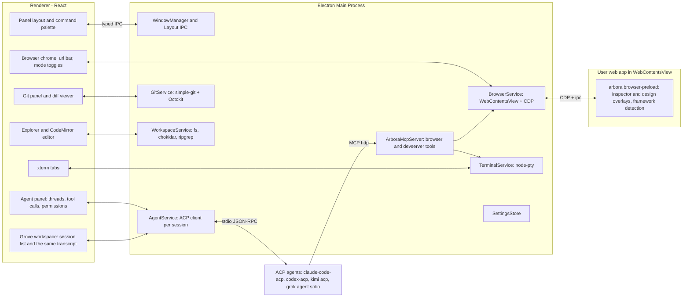

# Arbora: App Plan

Arbora is a cross-platform desktop app (Linux Arch/Debian, macOS, Windows) for building web apps by pointing at the running app instead of editing code. It is inspired by Cursor's design mode. The main panel is an embedded browser showing your dev server. A side panel hosts any ACP-compatible coding agent. Two modes act on the live page: agent mode (point at a component, describe a change) and design mode (visually edit, then hand the diff to the agent). A second workspace, Grove, replaces that layout with a manager for many ACP agents at once. The browser workspace stays the default.

The companion document [BUILD_STAGES.md](./BUILD_STAGES.md) breaks the build into stages with instructions, gotchas and a progress tracker. This file is the "what and why"; that file is the "how and when".

## Current phase

Live tracker: [BUILD_STAGES.md § Progress](./BUILD_STAGES.md#progress). Agents must update this section and that table at the end of every piece of work.

**Now:** Stages 0–9 are `Done`. Stage 9 is `Done` for now (6 Nov 2026, `v0.0.5`). Launch checks wait: **Cut a beta**, the packaged memory budget, a macOS `.dmg` open check, fresh installs per OS, and `arch-ok`. Stage 10 (Grove) is `In progress (PR #76, merged)` and is not `arch-ok`. Stage 11 (Stretch) is `In progress (PR #88, merged)` on `beta` ([PR #88](https://github.com/maplepreneur/arbora/pull/88), Linux CI [run 42239297446](https://github.com/maplepreneur/arbora/actions/runs/42239297446), green): the dev plugin ([PR #81](https://github.com/maplepreneur/arbora/pull/81)), worktrees ([PR #82](https://github.com/maplepreneur/arbora/pull/82)), Tailwind write-through ([PR #83](https://github.com/maplepreneur/arbora/pull/83)), design session history ([PR #84](https://github.com/maplepreneur/arbora/pull/84)), MCP action traces ([PR #85](https://github.com/maplepreneur/arbora/pull/85)), the opt-in TypeScript language server ([PR #86](https://github.com/maplepreneur/arbora/pull/86)) and source maps ([PR #87](https://github.com/maplepreneur/arbora/pull/87)). Local check of that combination on 6 Nov 2026: `pnpm typecheck`, `pnpm lint`, 812 unit tests, and e2e 56 passed / 1 skipped (the packaged memory budget). Not `arch-ok`. Stage 12 is in progress in draft [PR #91](https://github.com/maplepreneur/arbora/pull/91): the three-extension store, tabs, grants, the design-match loop (a hidden reference tab compared with the app, score below 0.92 then at or above it), cross-project "Open project and send", and CLI 1Password (address-bar fill, save after submit, a one-time code, and `browser_login`). A plain link opens as a reference tab on `persist:arbora-web`; an OAuth popup is a child window on that partition. Each compare round is saved under `.arbora/screenshots/<thread>/` and the Matching design card lists the scores and that path. Problems defaults to the app tab and can switch to a reference tab's own console. Settings and onboarding check for `op` without installing it, and a focused login field shows a 1Password key. The agent guide teaches the design-match loop. Always on an agent login remembers that site until it is removed in Settings. The design-match stop rule comes from the project (0.92 and 5 rounds unless changed). Local check on 6 Nov 2026: `pnpm typecheck`, 838 unit tests, and `e2e/tabs.spec.ts` (13 passed, including save, OAuth, the memory hover card, both compare-round files, the canvas-frame compare, the app-tab Problems filter, and the login-field key). The onboarding password step checks for `op`. The Stage 1 Problems e2e still passes. A canvas stand-in is opened in a background tab, navigated with `node-id`, read from its inspect text, and compared on the frame (`side_by_side`, `overlay`, `diff`) so the surrounding chrome is not scored. Viewport screenshots of a hidden tab use the same behind-the-visible-tab capture as compare.

**Next:** Stage 12 still needs a full `pnpm setup:1password --yes` install, the manual Figma matrix (OpenCode, then Kimi and Grok), and `arch-ok` on Omarchy/Hyprland. The 1Password extension popup stays out (`connectNative` is missing on Electron 45); `passwords.mode: auto` uses the `op` CLI. Grove and Stage 11 still need `arch-ok`. Stages 13–17 stay specified and not started. Stages 16 and 17 were specified in [PR #80](https://github.com/maplepreneur/arbora/pull/80).

**Blockers / open:** Grove and Stage 11 have no `arch-ok`. Stage 9 launch checks stay parked. Dependabot [#64](https://github.com/maplepreneur/arbora/pull/64) (`@types/node` 22 → 26) stays open: CI and `engines` are Node 22, and Electron 45 runs Node 24. `v0.0.5` is the latest stable. Distribution is unsigned GitHub Releases. Until someone runs **Cut a beta**, the Beta channel only offers stable releases. Stage 6's Appendix B design-save row is still empty. Claude Code and Codex stay built-in and untested. The macOS e2e clipboard step is still flaky. Agent mode's target picker is not filtered by sign-in yet. The Stage 8 scratch repo cannot be deleted with the current `gh` token.

---

## 1. Product summary

| Area | Summary |
| --- | --- |
| Browser panel | Embedded Chromium showing the user's dev server. URL bar, navigation, viewport presets, screenshots, console/network capture, React/Vue DevTools. |
| Agent panel | Any ACP agent (Claude Code, Codex, Kimi Code, Grok Build, OpenCode, custom). Streaming messages, tool calls, diffs, permissions, plans, slash commands. Docked beside the browser. |
| Grove | A second workspace that takes the whole window: every ACP session in the project with a live status, one transcript, a task-first launcher, and helper agents a lead agent can start and steer over MCP. Title-bar switch, hotkeys, a default agent, and the bell when an agent needs you. |
| Agent mode (`Mod+K`) | Inspector-style hover/click on components. Click opens a prompt popover. Submit sends prompt + component source + screenshot to the agent. |
| Browser control for agents | An MCP server exposing browser and dev-server tools (navigate, click, type, scroll, screenshot, snapshot, logs, restart) so the agent can verify its own work. |
| Design mode (`Mod+D`) | Webflow-like visual editing (text, spacing, layout, typography, colors, structure). Save sends before/after screenshots + change list + component sources to the agent. |
| Terminal panel | Tabs and splits, mostly for running dev servers. Detects dev-server URLs and opens them in the browser. |
| Git panel | Status, stage, hunks, commit, branches, log, push/pull, stash, GitHub PRs. Click a change to see a diff. |
| Files and editor | Explorer, quick open, ripgrep search, CodeMirror editor with highlighting and diagnostics. Zed-like lightness; hand editing is secondary. |
| Browser tabs | Several tabs per project: one **app tab** (the dev server) and any number of **reference tabs** (a Figma file, docs, the production site). A good-enough everyday browser, so you do not alt-tab to Chrome to log in or look something up. |
| Cross-tab agent work | Prompt from any tab and send it to a chosen project and thread. "Implement this design" from a Figma tab gives the agent read access to that tab. It studies the design, edits the project, screenshots the app tab and compares the two until they match. |
| Passwords (1Password) | The 1Password extension (or the `op` CLI as a fallback) fills and saves logins in every tab. A setup script installs and connects 1Password. Agents can ask Arbora to log in to a site but never see a password. |
| Themes | Light, dark and system stay. A `theme.json` can override the app's colour variables. Fonts and layout stay as they are. |
| Extensions | Settings installs from a short approved catalog. Browser entries are Svelte DevTools and Bitwarden. Coding entries are linters and tools, starting with Robocop. |
| Usage and cost | Each agent turn records input, output and cache tokens, the model that produced them, and the working time. Cost is those tokens times the provider's published API price for that model. The ledger is stored in the project first, and the app reads it from there. A later step copies the same rows into the account database so they are saved off the machine; the website reads that database. |
| Publish | Connect Vercel or Cloudflare Pages. Developers see deployments and ship from the app. A site owner gets a simpler window: change the website, preview it, and publish it, without git or a terminal. |

Design principles:

- The browser is the product. Everything else supports pointing at a thing and describing a change.
- Two workspaces, one window. The browser workspace is the default. Grove is the other full layout, for several agents at once. Switching parks the page and keeps agents running. Quitting the app stops them.
- Agents own their auth, models and tools. Arbora is a client, never a proxy for provider keys.
- Secrets stay with the user. Passwords, one-time codes and vault contents never enter a prompt, a tool result, a log or a screenshot sent to an agent. Agents can ask Arbora to log in; they cannot read what was filled.
- One Chromium. No extra webviews, no language servers by default, no product telemetry. An Arbora account is required (Stage 15): the account server learns the email, the plan, the app version and OS at entitlement refresh. It does not learn project paths, prompts or source. Stage 16 writes token counts, the model, list-price cost and working time into the project first. Saving usage to the account, off until the user turns it on, copies those rows into the account database.
- Every stage ends with an app you can actually use.

---

## 2. Stack decision

**Electron + TypeScript + React. Not Tauri.**

The browser panel needs four things that only Electron gives consistently across all three OSes:

1. A full Chromium with identical rendering on Linux, macOS and Windows.
2. Chrome DevTools Protocol (CDP) access to the embedded page (`webContents.debugger`).
3. Loading DevTools extensions (React DevTools, Vue DevTools) via `session.loadExtension`.
4. Injecting a preload script into arbitrary user pages, plus programmatic screenshots (`capturePage`).

Tauri uses the OS webview (WebKitGTK on Linux, WKWebView on macOS, WebView2 on Windows). There is no unified CDP, no extension loading, and rendering differs per platform. Lightness is achieved through architecture (one Chromium, lazy panels, no LSP by default), not runtime choice. See [ADR 0001](#adr-0001-electron-over-tauri).

### Core libraries

| Concern | Choice | Notes |
| --- | --- | --- |
| Shell | Electron (latest stable), `electron-vite`, TypeScript strict | `contextIsolation: true`, `sandbox: true`, no `nodeIntegration` anywhere |
| Package manager | pnpm workspaces | Monorepo with `apps/` and `packages/` |
| Renderer | React 19, Tailwind CSS, Radix primitives, `react-resizable-panels`, Zustand, `cmdk` | Typed IPC validated with `zod` |
| Browser panel | `WebContentsView` (not `<webview>`), `webContents.debugger` (CDP), `session.loadExtension` | Persistent partition `persist:arbora-browser` |
| Agents | `@agentclientprotocol/sdk` v2.x, stable v1 default entrypoint, fluent `client({ name })` API | Agents spawned as stdio child processes |
| Browser control | MCP server with `@modelcontextprotocol/sdk`, Streamable HTTP on `127.0.0.1`, per-session bearer token | Registered via ACP `session/new` `mcpServers` |
| Terminal | `node-pty` + `@xterm/xterm` (+ fit, webgl, search addons) | |
| Git | `simple-git` over system `git`; Octokit + OAuth device flow (reuse `gh` auth when present) | |
| Editor | CodeMirror 6 (`@codemirror/lang-*`, `@codemirror/lint`, `@codemirror/merge`) | LSP via `@codemirror/lsp-client` opt-in only |
| Files | `chokidar` (watch), `@vscode/ripgrep` (search) | |
| Packaging | `electron-builder`: AppImage, `.deb`, AUR PKGBUILD (wrapping tarball), notarized `.dmg`, NSIS `.exe` | `electron-updater` + GitHub Releases |
| Testing | Vitest (unit), Playwright for Electron (e2e) against `fixtures/` apps | Fixtures: Vite+React, Next.js, Nuxt, plain HTML |
| Primary dev target | Arch Linux, Omarchy, Hyprland (Wayland) | Electron runs natively on Wayland via `ELECTRON_OZONE_PLATFORM_HINT=auto` (set by Omarchy) |

### Agent launch commands (verified Oct 2026, all stdio JSON-RPC)

| Agent | Command | Auth |
| --- | --- | --- |
| Claude Code | `npx -y @zed-industries/claude-code-acp` | Claude login or `ANTHROPIC_API_KEY` |
| Codex | `npx -y @agentclientprotocol/codex-acp` | ChatGPT login, `CODEX_API_KEY` or `OPENAI_API_KEY` |
| Kimi Code | `kimi acp` | Prior `kimi` login. Supports image prompts and http/sse/stdio MCP |
| Grok Build | `grok agent stdio` (or `npx @xai-official/grok agent stdio`) | `grok login` or `XAI_API_KEY`; auth method ids `xai.api_key` / `cached_token` |
| OpenCode | `opencode acp` (OpenCode v2+) | `opencode auth login` (auth method id `opencode-login`). Does its own fs, shell and permissions; one `model` config option covering every configured provider |
| Custom | User-supplied `command`, `args`, `env` | Same shape as Zed's `agent_servers` |

---

## 3. Architecture



### Process model

- **Main process** owns all privileged services. Each service is a class with a zod-validated IPC surface. No business logic in IPC handlers; handlers call services.
- **Renderer** is a single React app. It never touches Node. It talks to main over `contextBridge` APIs defined in `packages/shared` (request/response and event subscriptions).
- **Browser preload** (`browser-preload.ts`) is injected into the user's page via the `WebContentsView` `webPreferences.preload`. It runs in an isolated world, exposes nothing to the page, and communicates with main over a private IPC channel. It hosts the inspector overlay, design overlay, framework detection and source resolution.
- **Agents** are child processes spawned by `AgentService`. Arbora is the ACP client. Each session also gets an MCP server URL for browser control.

### Key flows

**Agent mode prompt**

1. User presses `Mod+K`; main tells the browser preload to enable the inspector overlay.
2. Hover highlights elements with box model and component label (e.g. `Button <- CardHeader <- Card`).
3. Click freezes selection and opens a prompt popover (rendered by the renderer, anchored using element rect forwarded from preload).
4. On submit, `BrowserService` resolves component context (see 4.3), captures a screenshot with the element outlined, and the renderer composes an ACP prompt with text, image and resource_link blocks.
5. `AgentService.prompt(sessionId, blocks)` streams updates back to the agent panel.

**Agent verification loop**

1. Agent edits files (via its own tools or ACP `fs/write_text_file`).
2. The dev server hot-reloads.
3. Agent calls MCP tools `browser_screenshot`, `browser_snapshot`, `devserver_logs`, compares with the request, iterates.
4. Agent finishes with a summary and a final screenshot.

**Design mode save**

1. On `Mod+D`, preload takes a "before" screenshot and enables the design overlay.
2. Every edit is recorded as an op `{ target, kind, before, after }` and applied live to the DOM as inline styles / mutations. The dev server is untouched.
3. On Save, Arbora captures an "after" screenshot, renders the op list as a readable change list, attaches resolved component sources and the detected styling approach (Tailwind, CSS modules, styled-components, plain CSS), and sends it to the agent.
4. Discard reverts the DOM. Sessions are stored in `.arbora/design-sessions/` for re-send.

### Repository layout

```
arbora/
  apps/desktop/                 electron-vite app
    src/main/                   services, IPC registration, window management
    src/preload/                app preload (contextBridge) and browser-preload (injected into user pages)
    src/renderer/               React app
  packages/shared/              zod IPC schemas, domain types, feature-flag constants
  packages/acp-client/          agent registry, spawning, ACP session wrapper, update normalization
  packages/browser-bridge/      CDP helpers, overlay scripts, framework detection, source resolution
  packages/mcp-browser-server/  MCP tool definitions and server
  fixtures/                     sample apps for e2e: vite-react, next, nuxt, plain-html
  docs/                         PLAN.md, BUILD_STAGES.md
  AGENTS.md                     conventions for the builder agent
```

### Per-project data (`.arbora/` inside the user's project)

```
.arbora/
  project.json          dev command, dev URL, keybinding overrides, default agent, Grove open-default flag
  threads/              persisted agent threads (JSON)
  usage/                per-thread token, model, cost and time ledger (Stage 16; gitignored with the rest of this folder)
  screenshots/          screenshots for agents that lack image prompt support
  design-sessions/      saved design-mode op lists + before/after screenshots
  SKILL.md              browser-control instructions for agents that read skills
```

`.arbora/` is added to `.gitignore` by Arbora on first run (with user consent), except `project.json`, which is meant to be committed.

### Security

- `contextIsolation`, `sandbox`, no `nodeIntegration`, CSP on the renderer, `setWindowOpenHandler` on every `webContents`.
- Browser preload runs in an isolated world; the user's page cannot call Arbora APIs.
- MCP server bound to `127.0.0.1`, random port, per-session bearer token, requests without a valid token are rejected.
- ACP `fs/*` handlers are path-scoped to the project root (resolve + prefix check, deny symlink escapes).
- Agent navigation off the dev-server origin requires a one-time allow.
- No remote code loading, no product telemetry. The usage ledger (Stage 16) is written under `.arbora/usage/` first. Saving to the account copies those rows into the account database and leaves the local files in place. A saved row has no prompts, paths or source. Host tokens (Stage 17) stay in the OS keychain and never enter a prompt.
- Agents see a reference tab only after the user sends a prompt from it or grants it (`F-XTAB-03`). Agent-driven logins go through a permission card and the password manager, never through the agent (`F-VAULT-04`). Password-field values are redacted from snapshots, `browser_evaluate` results and the ACP log.

---

## 4. Feature specification

Feature IDs (`F-AREA-NN`) are referenced from [BUILD_STAGES.md](./BUILD_STAGES.md).

### 4.1 Shell and layout (`F-SHELL`)

- `F-SHELL-01` Open a project folder (dialog, recent projects, drag-and-drop). One window per project.
- `F-SHELL-02` Browser workspace layout: centre browser panel, right agent panel, bottom drawer (Terminal, Git, Problems), left activity rail (Files, Git, Search). Resizable, collapsible, persisted per project. Grove (`F-GROVE`) replaces this whole layout while it is active. The saved browser layout is restored on the way back.
- `F-SHELL-03` Command palette (`Mod+Shift+P`).
- `F-SHELL-04` Keybinding service with JSON settings and a settings UI. Defaults: `Mod+K` agent mode, `Mod+D` design mode, `Esc` exit mode, `Mod+P` quick open, `Mod+Shift+P` command palette, plus the Grove chords in `F-GROVE-02`.
- `F-SHELL-05` `Mod` = Cmd on macOS, Ctrl on Linux and Windows. Super is deliberately not used: Omarchy binds `Super+K` to its keybindings viewer, Windows binds `Win+K`/`Win+D`, and GNOME grabs many Super chords, all at a level the app cannot intercept. Mode chords and the Grove workspace chords must also work while the embedded browser has focus (intercepted in main via `before-input-event` before the page sees them). Plain `Ctrl` chords are passed through to the shell when a terminal is focused. Every binding is configurable.
- `F-SHELL-06` Dark/light/system theme, system fonts, no telemetry. Colour overrides live in `F-THEME`.
- `F-SHELL-07` Projects page and project groups (Stage 9): the window without a project lists Pinned, the user's project groups (name, colour, order, collapsed) and Recent, with a filter. Pinned and grouped projects stay listed after they leave the ten recents. Each row has an alias, reveal, and remove. Open projects show a dot, and the number of their agent threads that need the user. **Switch Project…** (`Mod+Alt+O`, intercepted, and a click on the title-bar project name) opens the same list as a palette. Groups live in `settings.projectGroups`; pin, group and alias are machine-local fields of `settings.projects[path]`.

### 4.2 Browser panel (`F-BROWSER`)

- `F-BROWSER-01` URL bar, back/forward/reload, hard reload, open external, DevTools toggle, zoom.
- `F-BROWSER-02` Viewport presets (desktop/tablet/mobile widths, DPR) rendered by resizing the `WebContentsView` inside a letterboxed container.
- `F-BROWSER-03` Auto-detect dev-server URLs printed in terminals and offer "Open in browser".
- `F-BROWSER-04` Persistent session partition per project (logins survive restarts), with a "reset browser data" action.
- `F-BROWSER-05` CDP attached on load: console messages and network failures buffered and shown in the Problems tab.
- `F-BROWSER-06` Screenshot API: full viewport, element clip, optional highlight burn-in. PNG, returned as base64 and optionally written to `.arbora/screenshots/`.
- `F-BROWSER-07` Bundled unpacked React DevTools and Vue DevTools loaded into the browser partition (never read from the user's Chrome profile).
- `F-BROWSER-08` Browser preload bootstrap with a private IPC channel to main.

### 4.3 Agent mode (`F-INSPECT`)

- `F-INSPECT-01` Inspector overlay: hover highlight with box model, component label, breadcrumb to pick ancestors, `Esc` exits, `Mod+K` toggles.
- `F-INSPECT-02` Click opens an anchored prompt popover: multiline input, Enter submits, `Shift+Enter` newline, attachment chips (component source, screenshot, console errors), agent/session selector.
- `F-INSPECT-03` Framework detection in page: React (`__REACT_DEVTOOLS_GLOBAL_HOOK__.renderers` or `__reactFiber$*` keys on DOM nodes), Vue 3 (`__vue_app__`, `__vueParentComponent`), Next (`__NEXT_DATA__` / `next` global), Nuxt (`__NUXT__`), Svelte (`__svelte`), Angular (`ng`), fallback plain HTML.
- `F-INSPECT-04` Component source resolution tiers (best wins; tier reported in the prompt):
  1. Exact file:line from a build-time attribute (`data-arbora-src`, or compatible `code-inspector-plugin` / `data-source` attributes) when the optional `@arbora/dev-plugin` is installed (stretch).
  2. Framework internals: React fiber `_debugSource` (React <= 18) or `_debugOwner` / owner stacks (React 19) plus component `displayName`; Vue component `__file` and `name`.
  3. Component name chain + trimmed `outerHTML`, class list, text content, computed-style subset, bounding box. The agent greps the workspace by component name and class names.
- `F-INSPECT-05` Prompt payload: user text, framework and tier, resolved paths as ACP `resource_link` blocks, trimmed HTML, screenshot as ACP `image` block (PNG base64) with the element outlined, relevant console errors, and a standard instruction block asking the agent to verify using browser tools.
- `F-INSPECT-06` Fallback for agents without image prompt capability: write the screenshot to `.arbora/screenshots/` and reference the path.

### 4.4 Agent panel (`F-AGENT`)

- `F-AGENT-01` Agent registry: built-ins (Claude Code, Codex, Kimi Code, Grok Build, OpenCode) and custom entries; binary detection with install hints; per-agent env overrides.
- `F-AGENT-02` Session lifecycle: `initialize` (advertise `fs.readTextFile`, `fs.writeTextFile`, `terminal: true`), `authenticate` with the agent's advertised methods (device/browser logins surfaced in UI), `session/new` with project cwd and the Arbora MCP server, `session/load` / `session/resume` when supported, `session/cancel`.
- `F-AGENT-03` Mode and model pickers via `session/set_mode` / `session/set_model` when advertised.
- `F-AGENT-04` Streaming UI for `session/update`: message chunks (markdown), thoughts (collapsible), tool calls with status, locations and diffs, plan/todo lists, available commands (slash commands).
- `F-AGENT-05` Permission requests: allow once / always / reject, per-tool remembered choices.
- `F-AGENT-06` Client-side methods: `fs/read_text_file`, `fs/write_text_file` (project-scoped, feeding the Git panel's "Agent changes" group), `terminal/*` backed by `TerminalService` (visible as tabs), `session/request_permission`.
- `F-AGENT-07` Multiple threads per project, persisted locally, with titles and pinned context. The docked panel and Grove (`F-GROVE-07`) are two views of this same list. Creating or archiving a thread in either place updates the other. Each workspace remembers its own selected thread.
- `F-AGENT-08` ACP log viewer (raw JSON-RPC both directions) for debugging.
- `F-AGENT-09` Image and embedded-context prompt blocks when the agent's `promptCapabilities` allow; otherwise fall back per `F-INSPECT-06`.
- `F-AGENT-10` Stop is always available while an agent works or starts: in the composer (also `Esc` there), in the thread header, on the thread's row, and as **Stop Agent** (`Mod+.`). Stop sends `session/cancel`. If the agent has not ended the turn after 3 s, or it is still starting or waiting for a login, Arbora stops the agent process. The next prompt starts it again and restores the session where it can.
- `F-AGENT-12` Agent groups and pinned threads (Stage 9): the thread list shows Pinned, then the project's agent groups, then the rest. A group has a name, a colour, an order and a collapsed state, saved in `.arbora/agent-groups.json`; a thread's `groupId` and `pinned` are in its thread file. A group header shows "N working · N need you" and offers New thread in group, rename, recolour, move up/down, stop every agent in it, and delete (threads stay, ungrouped). Inspired by Herdr's herds and Solo's stacks; Grove (Stage 10) shows the same groups.
- `F-AGENT-13` Attention, notifications and sounds (Stage 9): a thread needs the user while a permission card or a login waits, and after a turn finished (not cancelled) or failed until the user looks at it. The title-bar bell shows the count and **Show Agent That Needs You** (`Mod+Alt+A`) opens the oldest. Transitions into one of those states play a short synthesized sound and, unless that thread is on screen in a focused window, show a desktop notification whose click opens the thread. The dock/launcher badge and a taskbar flash show the total across windows. Each part is a setting (`notifications.*`, `sounds.*`). Grove's badge (`F-GROVE-06`) reuses this attention state.
- `F-AGENT-11` Default agent and model for new threads, plus favourite models:
  - Default agent: pin an agent in the agent picker. The project's `defaultAgent` wins over the app setting `agents.defaultAgent`. "New thread" (and `Mod+Shift+N`) then starts that agent directly, and the chevron still opens the picker.
  - Default model: pin a model in the model picker (`agents.defaultModels[agentId]`). It is applied right after `session/new` for brand-new threads. Restored sessions keep their model.
  - Favourite models: star models in the model picker (`agents.favoriteModels[agentId]`). They are listed first under "Favourites".

### 4.5 Browser control for agents (`F-MCP`)

- `F-MCP-01` `ArboraMcpServer` in main, Streamable HTTP on `127.0.0.1:<random>`, per-session bearer token, registered in `session/new` `mcpServers` (http). A stdio shim command is provided for agents that only support stdio MCP.
- `F-MCP-02` Browser tools: `browser_navigate`, `browser_reload`, `browser_back`, `browser_screenshot` (viewport / full page / element by selector or ref), `browser_snapshot` (accessibility tree with element refs), `browser_click`, `browser_type`, `browser_press_key`, `browser_hover`, `browser_scroll`, `browser_select_option`, `browser_wait_for` (selector / text / network idle), `browser_evaluate` (sandboxed JS), `browser_console_logs`, `browser_network_errors`, `browser_get_element_source` (reuses `F-INSPECT-04`), `browser_set_viewport`.
- `F-MCP-03` Dev-server tools: `devserver_status`, `devserver_logs` (tail from the terminal ring buffer), `devserver_restart` (uses `.arbora/project.json` dev command), `terminal_run` (short-lived command with captured output and timeout).
- `F-MCP-04` Tool calls surface in the agent panel; navigation off the dev-server origin requires a one-time allow.
- `F-MCP-05` Agent instructions: Arbora injects an instruction block into the first prompt of each session and writes `.arbora/SKILL.md`, describing the loop: inspect -> edit -> wait for HMR -> screenshot -> compare -> finish with summary and final screenshot.

### 4.6 Design mode (`F-DESIGN`)

- `F-DESIGN-01` Selection model shared with the inspector overlay; multi-select with Shift.
- `F-DESIGN-02` Inline text editing (contenteditable on text nodes) with original text captured.
- `F-DESIGN-03` Properties panel (replaces agent panel while active): Layout (display, flex/grid, direction, align, justify, gap, wrap), Spacing (margin/padding with drag handles), Size, Position, Typography, Background and Borders (color, radius, border, shadow), Opacity/Visibility.
- `F-DESIGN-04` Tailwind mapper: when the project uses Tailwind, CSS edits are translated to suggested utility classes.
- `F-DESIGN-05` Structure ops: move within parent or into a sibling container (drag with drop indicators), duplicate, delete, insert basic element (div/text/image/button).
- `F-DESIGN-06` Undo/redo stack; live preview via inline styles and DOM mutation; the dev server is never touched during editing.
- `F-DESIGN-07` Change tracking as an ordered op list: `{ target: { componentChain, selector, source? }, kind: style | text | attr | move | insert | delete, before, after }`.
- `F-DESIGN-08` Save: before screenshot (taken at mode entry), after screenshot, human-readable change list, resolved component sources, detected styling approach, sent to the selected agent. Discard reverts the DOM.
- `F-DESIGN-09` Design sessions saved in `.arbora/design-sessions/` and re-sendable.
- `F-DESIGN-10` (Stretch) Direct write-through for exact-tier Tailwind class edits without an agent round trip.

### 4.7 Terminal panel (`F-TERM`)

- `F-TERM-01` Multiple tabs and splits, shell detection per OS (zsh/bash/fish, PowerShell), cwd = project, link detection, search, copy/paste, clear, kill.
- `F-TERM-02` Login-shell PATH on macOS and Linux GUI launches so `kimi`, `grok`, `node`, `pnpm` resolve.
- `F-TERM-03` "Run dev server" quick action from `.arbora/project.json`, with URL auto-open (`F-BROWSER-03`).
- `F-TERM-04` Output ring buffer per terminal (for `devserver_logs`).
- `F-TERM-05` Agent-created ACP terminals appear as read-only tabs with a badge.

### 4.8 Git panel (`F-GIT`)

- `F-GIT-01` Status with staged/unstaged/untracked groups, stage/unstage file and hunk, discard.
- `F-GIT-02` Commit, amend, agent-generated commit message on request.
- `F-GIT-03` Branch list/create/switch, log with graph, push/pull/fetch, stash, remotes.
- `F-GIT-04` Clicking a change opens the diff viewer (CodeMirror merge view, side-by-side or inline, word diff).
- `F-GIT-05` Explorer shows git status decorations.
- `F-GIT-06` GitHub: OAuth device flow or `gh` auth reuse; create PR (agent-drafted title/body on request), list PRs for the branch, open in browser, CI status badges.
- `F-GIT-07` "Agent changes" group: files written by agents (ACP `fs/write_text_file` plus watcher-detected changes during a turn) grouped for review.

### 4.9 File explorer and editor (`F-FILES`, `F-EDITOR`)

- `F-FILES-01` Tree with lazy loading, watcher, create/rename/delete, reveal in OS.
- `F-FILES-02` Quick open (`Mod+P`) with fuzzy search.
- `F-FILES-03` Project text search via ripgrep with include/exclude globs.
- `F-EDITOR-01` CodeMirror 6 editor: TS/JS/TSX/JSX/HTML/CSS/JSON/MD/Vue/Svelte/Python/Go/Rust, bracket matching, folding, multi-cursor, tabs, dirty indicators, image preview.
- `F-EDITOR-02` Format on save via the project's Prettier when present.
- `F-EDITOR-03` Diagnostics on save by running project ESLint / `tsc` (cheap, no daemon).
- `F-EDITOR-04` LSP (`@codemirror/lsp-client` + `typescript-language-server`) as an opt-in setting.

### 4.10 Onboarding and settings (`F-ONBOARD`)

- `F-ONBOARD-01` First-run: pick project, detect dev command from `package.json` scripts, detect installed agents, test-launch chosen agent, verify keybindings. The Grove step (pick a default agent, press the workspace chord once) is added by Stage 10, not by the first version of this wizard.
- `F-ONBOARD-02` Settings UI and JSON: agents (custom agents, env overrides, adapter versions), keybindings (an editor with conflict detection), the light/dark/system theme, notifications and sounds, browser partition reset, MCP tool permissions, dev-server command, screenshot storage, updates and diagnostics. The Grove section (`notify`, fallback agent) is added by Stage 10. Colour packs are Stage 13. The extension catalog is Stage 14. Model price overrides and usage sharing are Stage 16. Host connections are Stage 17.

### 4.11 Non-functional (`F-NFR`)

- `F-NFR-01` Security requirements listed in section 3.
- `F-NFR-02` Performance targets: idle RSS under ~350 MB with the browser loaded, panel open under 100 ms, screenshot under 300 ms.
- `F-NFR-03` CI matrix (ubuntu, macos, windows): typecheck, lint, unit, e2e smoke, package artifacts on tags.
- `F-NFR-04` Signed and notarized builds, auto-update.

---

### 4.12 Grove (`F-GROVE`)

Grove is the other workspace. The browser workspace stays the one the app opens on: the page in the centre, one agent docked beside it, the terminal underneath. Grove takes that whole area and turns it into a manager for every ACP agent in the project: a list of sessions with a live status each, one transcript at a time, a task-first way to start more, and helpers that a lead agent can start and steer itself. The name is the workspace, the command category, and the list heading. A grove is a tended group of trees; this view is the group of agents working the project the browser is shaping.

Agents are child processes of Arbora. Switching to the browser leaves them running. Quitting Arbora stops them, and the empty state says so. Grove keeps Arbora's ACP client (ADR 0002, ADR 0004): the main pane is the structured Stage 3 transcript (messages, thoughts, tool calls, diffs, plans, permissions), not a copy of the agent's terminal UI.

- `F-GROVE-01` Title-bar switch. Grove replaces the browser layout; the page is parked, not reloaded.
- `F-GROVE-02` Hotkeys, including chords that only apply inside Grove.
- `F-GROVE-03` Session list: derived status, stable order, helpers nested under their lead, rename, stop, restart, archive, Recent.
- `F-GROVE-04` Default agent, and starting it when Grove opens empty.
- `F-GROVE-05` Session pane: the shared transcript, a pinned permission card, the composer, and a Changes tab.
- `F-GROVE-06` Attention: the Stage 9 bell, notifications and jump, aware of which workspace is showing.
- `F-GROVE-07` One thread list shared with the docked agent panel. Each workspace keeps its own selection.
- `F-GROVE-08` Narrow window: the list collapses to a rail.
- `F-GROVE-09` What a switch does to agent mode, design mode, terminals and the page.
- `F-GROVE-10` Task-first launcher: pick an agent and model, type the task, Enter starts the session with that task.
- `F-GROVE-11` At a glance: the live activity line, a working timer, diff stats, and a warning when two sessions edit the same file. Stage 16 persists that working time on the usage ledger.
- `F-GROVE-12` Orchestration: a lead agent starts, prompts, waits for, reads and stops helper sessions through MCP tools.

#### What the popular tools do, and what Grove takes

Researched 4 Nov 2026. The field: [Solo](https://soloterm.com/) and [Herdr](https://herdr.dev/) (named in the brief), then Conductor, Claude Squad, Superset, Emdash, Nimbalyst (Crystal's successor), Vibe Kanban (its company shut down in April 2026; the code is community-maintained), Sculptor, Orca and Paseo. Codex and Cursor ship parallel agent threads in their own apps.

| Tool | Idea | Grove |
| --- | --- | --- |
| Solo | A meta-harness: a lead agent spawns agents from other harnesses through Solo's MCP server, splits the work, waits for them and collects the result. Its most-used calls are "get output", "get status" and "send input". | Taken (`F-GROVE-12`): `grove_start_agent`, `grove_send`, `grove_wait`, `grove_read`, `grove_stop`, `grove_list_agents` on the MCP server every session already has. Helpers are ordinary Grove sessions you can open and answer. |
| Solo | A status per agent (working, idle, waiting, blocked); one shared `solo.yml` process manifest so agents reuse the running dev server instead of starting another. | Status taken (`F-GROVE-03`). The shared dev server already exists: every session's browser tools drive the one dev server and page in the browser workspace (Stage 5). |
| Solo | Scratchpads, todos with dependencies, prompt templates, timers. | Timers taken (`F-GROVE-11`). Scratchpads, todos and templates are later work (see Out of scope). |
| Herdr | The sidebar shows who is working, blocked or done, so you see who needs you; agents can start helpers that report back; elapsed timers. | Taken: status dots and words, the attention jump, helpers nested under their lead (`F-GROVE-12`), a working timer and "worked for" (`F-GROVE-11`). |
| Herdr | A background server keeps agents alive after the window closes; SSH to other machines. | Not taken: a second product that must be trusted with the project (ADR 0004). |
| Conductor, Superset | A workspace per task with a stable list; `⌘1`–`⌘9` jump to the Nth workspace; diff stats on each row; "ready for review"; archive and restore. | Taken: stable creation order, `Mod+1`–`Mod+9` inside Grove, `+12 −3` on the row, Done, archive to Recent and Restore. |
| Conductor, Claude Squad, Superset, Emdash | A git worktree and branch per session, so parallel agents do not edit the same checkout. | Not in this stage. A worktree needs its own dev server, port and page to verify against (Stage 11 "Worktree sessions"). Grove warns when two live sessions edited the same file instead (`F-GROVE-11`). |
| Claude Squad | `n` starts a session, `N` starts one with a prompt; preview and diff tabs per session. | Taken: the split button and `Mod+Alt+N` start the default at once; `Mod+Shift+N` opens the task-first launcher (`F-GROVE-10`); the pane has Transcript and Changes tabs (`F-GROVE-05`). |
| Vibe Kanban, Nimbalyst | A board: drag a card to In Progress and an agent picks it up. | Not taken: the list with status sections answers the same question with less UI. A board can come later on the same data. |
| Emdash, Conductor | Start from a Linear, GitHub or Jira issue; CI checks per workspace. | Not in this stage. The Git panel already shows checks for the branch (Stage 8). |
| Codex, Cursor | Several agent threads side by side in one app. | Already true in the docked panel (Stage 3); Grove gives them the whole window. |

The things every tool agrees on, and that Grove must get right first: a status you can read without opening the session, a one-key jump to the agent that needs you, and starting a session with its task in one step.

#### Layout

The switch sits in the title bar, in the right-hand cluster, immediately left of the attention bell (Stage 9), which sits left of the Commands button. It is a two-segment control, the same height as that button (`h-6`), `app-no-drag`, with a border.

```
┌──────────────────────────────────────────────────────────────────────────────┐
│ 🌲 Arbora / vite-react ▾  [Freestyle|Agent|Design]  [Browser|Grove•] 🔔2  Commands ◐ │
└──────────────────────────────────────────────────────────────────────────────┘
```

- Left segment: lucide `AppWindow`, label "Browser", `data-testid="workspace-browser"`.
- Right segment: lucide `Trees`, label "Grove", `data-testid="workspace-grove"`.
- The active segment uses `bg-accent-soft` and `text-accent`, and `aria-pressed="true"`. The inactive segment is `text-fg-muted`.
- Each segment's tooltip names the toggle chord (`Mod+Alt+G`).
- While the browser workspace is showing and any session is working, the Grove segment shows a small accent dot (`data-testid="grove-activity"`) that pulses unless reduced motion is on. The count of agents that need you stays on the bell. There is one badge, not two.
- Under a 640px-wide title bar the labels hide and the icons stay, like the mode pills. The project name truncates before the switch is clipped.
- With no project open, the switch is not shown. The toggle chord toasts "Open a project first."

Activating Grove unmounts the browser workspace (activity rail, sidebar, browser chrome, docked agent, bottom drawer) and mounts Grove in the content area under the title bar. Activating Browser does the reverse. This is a layout switch, not a panel collapse. The browser `WebContentsView` is parked the same way it is while Settings covers the centre: `setVisible(false)` with its last bounds kept, not destroyed, not reloaded, not resized to zero (a zero-size view captures empty screenshots, and agents in Grove still verify their work with `browser_screenshot`). Coming back shows the view at the rect the remounted panel sends. Terminal pty sessions and their xterm instances stay alive; the terminal panel already reattaches on mount. ACP processes stay alive.

```
┌──────────────────────┬───────────────────────────────────────────────────────┐
│ Grove  2 working  [New agent ▾]│ ● fix the nav   Working · Claude Code  ■ ⟳ ⋯│
│──────────────────────│  Transcript | Changes 3                               │
│ ● fix the nav    2m  │───────────────────────────────────────────────────────│
│   Edit src/Nav.tsx   │  opus · Ask before edits                              │
│   ↳ ● tests     40s  │                                                       │
│       Run pnpm test  │   transcript (the Stage 3 components)                 │
│ ● Codex     +12 −3   │                                                       │
│   Needs you: Allow…  │───────────────────────────────────────────────────────│
│ ○ Grok               │  Allow edit to src/App.tsx?  Allow once  Always  Reject│
│   Stopped            │───────────────────────────────────────────────────────│
│ ▸ Recent (4)         │  Ask Claude Code…                               Send  │
│ Default: Claude Code │                                                       │
└──────────────────────┴───────────────────────────────────────────────────────┘
```

The two columns are a `react-resizable-panels` group `arbora.grove` (list id `grove-list`, main id `grove-main`), list default 24%, minimum 180px, maximum 45%. Sizes persist the same way as the browser layout (`layout.groups`). `Mod+B` in Grove collapses and restores this list and does not touch the files sidebar. Under 520px of content width the list becomes a 44px rail of status dots with tooltips, and that forced size is not written back. A wide window restores the saved size. The browser layout's 764px minimum does not apply here.

The list header is the word "Grove", a summary ("2 working · 1 needs you"), and one split button that mirrors the docked panel's New thread button: the main click starts the default agent on its default model (or opens the launcher when there is no default), and the chevron opens the launcher. Under the list: **Recent** (archived sessions, collapsed) and a footer with the default agent, **Change**, and the "Start when Grove is empty" checkbox.

A row is two lines, about 44px:

- Line one: an 8px status dot, the display name, and on the right the working timer (`2m`) while a turn runs, else the diff stats (`+12 −3`) when the session edited files.
- Line two: the activity line. Needs you shows the permission title (or "Log in"). Working shows the current tool call's title, else the plan's progress (`Plan 2/5`), else "Thinking…". Done and Idle show the first line of the last agent message. Failed shows the error. Stopped says "Stopped".
- A warning triangle when another live session edited one of the same files; its tooltip names the file and the other session.
- Helpers started by a lead (`F-GROVE-12`) sit under it, indented, with a "↳".

Sections follow the docked list (Stage 9): Pinned, then each agent group with its header and summary, then the rest. Inside a section, sessions stay in creation order (oldest first), so a row's place does not change while you reach for it and `Mod+1`–`Mod+9` always mean the same row. That is how Conductor, Superset and Claude Squad order their lists. The status, not the position, says who needs you; the bell and **Show Agent That Needs You** jump there.

The pane header is one row: the status dot, the display name (double-click renames), the status word and agent name, then Stop or Restart, Archive and an overflow menu (Pin, Rename, Set as default agent, Show ACP log, Delete). A lead shows its helpers as chips you can click; a helper shows "Helper of {lead}". Under it, the Transcript and Changes tabs. Transcript is the Stage 3 thread view (mode, model and thinking pickers, auth card, transcript, composer). Changes lists the files this session edited with `+`/`−` counts; a row expands to the unified diff, and **Open diff** opens it in the editor, switching to the browser workspace. A pending permission card is pinned between the transcript and the composer, not only inside the scrollback; the docked panel does the same. The composer placeholder is `Ask {name}…`. Selecting a session focuses the composer.

Settings (`Mod+,`) opens in the pane area while Grove is showing, the same way it replaces the browser in the browser workspace.

#### How a session looks

Status is derived from the ACP session and the Stage 9 attention state, not from terminal output (`deriveSessionStatus` in `packages/shared/src/grove.ts`).

| Status | When | Dot |
| --- | --- | --- |
| Needs you | A permission request has no answer, or the agent is waiting for a login | Attention |
| Failed | The process crashed or a request failed (status `error`), or an unread failure | Danger |
| Working | A prompt turn is in flight and nothing is waiting on the user | Accent, pulsing |
| Starting | Process spawned; `initialize` / auth / `session/new` not finished | Muted, pulsing |
| Done | A turn ended (any `stopReason` except `cancelled`) and the session has not been looked at since | Accent, solid |
| Idle | The process is alive, no turn in flight, nothing unread | Green, solid |
| Stopped | No process: the user stopped it, it was archived, or Arbora restarted. Sending a message starts it again (Stage 3 load/resume) | Empty ring |

A cancelled turn does not become Done. Done clears when that session is on screen in a focused window (the Grove selection while Grove shows, or the docked panel's open thread in the browser workspace). Pulsing respects `prefers-reduced-motion`.

The display name is the thread title once it is not the default "New thread" (the first prompt sets it, and the launcher sets it from the task). Before that it is the agent name, with ` 2`, ` 3` by creation order among the untitled, unarchived sessions of the same agent. Rename sets the thread title (`F-AGENT-07`).

The working timer counts from the turn's first user message. When the turn ends, the row keeps "worked 4m" in its tooltip. Stage 16 stores that duration on the usage ledger so a restart does not have to replay the transcript to show it. Diff stats add up the `diff` content of the session's tool calls in this run: per file, the first `oldText` against the last `newText`, counted by changed lines. Sessions restored from disk show them once their transcript is loaded.

Row menu (right-click or `⋯`): Pin, Rename, Move to group, Set as default agent, Stop or Restart, Archive. **Stop** ends the process and keeps the row (Stopped); **Restart** starts it again. **Archive** stops the process and moves the session to Recent. It asks "Stop {name} and archive it? The transcript stays in Recent." only while the process is alive; otherwise it archives at once and the toast offers **Undo**. Recent shows the five most recently archived sessions, then **Show all**. Selecting one shows its transcript read-only with a banner and **Restore**, which brings it back to the list; the Stage 3 load/resume rules apply when you next send it a message. The docked thread list hides archived threads. **Delete** (from the overflow menu) removes the thread file.

#### Default agent

The default is the project `defaultAgent` in `.arbora/project.json`, then `settings.agents.defaultAgent` (the app-wide star from the agent picker), then none (`resolveDefaultAgent`). An id that is not in the registry is treated as none. The launcher's "Use as default for this project", the row's **Set as default agent**, the footer's **Change** and Settings → Grove write the project `defaultAgent`. None of them spawn a session.

Opening Grove starts one session of the default agent only when all of these are true: the project has no unarchived sessions, a default is set, that agent is detected, `startDefaultOnOpen` is on (`.arbora/project.json`, default on), and this visit has not already tried (`shouldStartDefaultSession`). Toggling Browser → Grove → Browser does not start another. A failed start does not retry on its own; the pane shows the Stage 3 install or login hint and **Retry**. The "already tried" flag resets when leaving Grove.

When that auto-start does not run and nothing is listed, the pane is centred copy: "No agents running." With a default, the primary button is "Start {name}" and the secondary is "New agent with a task…". Without one, the primary button is "Choose an agent". Below them is the "Start {name} when Grove opens empty" checkbox, then: "Agents keep running while you switch back to the browser. Quitting Arbora stops them."

#### Task-first launcher

**New agent…** (the split button's chevron, `Mod+Shift+N` while Grove shows, or `Mod+Alt+N` with no default) opens a dialog (`components/Dialog.tsx`, `data-testid="grove-launcher"`):

- The agents a picker may offer (signed in and visible, the default first), each with its models (`visibleModels`). The dialog is two stages: the lists first (↑↓ in the focused list, ←→ between agent and model, Enter opens the task, Ctrl+Enter or ⌘↩ starts with an empty task), then the task box ("What should it work on? Leave it empty to just start the agent.") where Enter starts, Shift+Enter is a new line, and Escape returns to the lists.
- "Use as default for this project".
- **Start** creates the session (titled with the task's first line), selects it, and sends the task as its first prompt.

#### Orchestration

Every agent session already has Arbora's MCP server (`arbora-browser`, Stage 5). When `settings.grove.orchestration` is on (default on), a session that is not itself a helper also gets these tools. They work on the project's Grove sessions, so the helpers they start are rows you can open, answer and stop like any other.

| Tool | Does |
| --- | --- |
| `grove_list_agents` | The agents you can start (id, name, signed in), the default, and the project's sessions (id, name, agent, status, whose helper) |
| `grove_start_agent` | `{ task, agent?, model?, title? }`: start a helper (the project default when `agent` is omitted), send it the task, return its session id at once |
| `grove_send` | `{ sessionId, message }`: prompt one of your helpers that is not working |
| `grove_wait` | `{ sessionIds?, until: 'all' \| 'any', timeoutSeconds }`: wait (default 45 s, at most 300 s) until your helpers are settled (Done, Idle, Needs you, Failed or Stopped), then return each one's status and last message. The default stays under the 60 s request timeout of the MCP SDK client and Codex |
| `grove_read` | `{ sessionId, limit? }`: the helper's recent transcript as text (messages, tool call titles, permission titles; no raw tool input) |
| `grove_stop` | `{ sessionId }`: stop one of your helpers |

Rules:

- One level. Helpers do not get the Grove tools, so a helper cannot start helpers.
- A lead can only send to, wait for, read and stop its own helpers. Listing shows every session.
- At most `settings.grove.maxChildren` (default 4) running helpers per lead.
- The first `grove_start_agent` in a session raises a permission card in the lead's thread ("{lead} wants to start helper agents"). Allowing it holds for that session. Rejecting returns an error the agent can relay.
- A helper's permission requests come to you as Needs you. A lead never answers them. `grove_wait` returns when a helper needs you, so the lead can say so.
- A helper's finished turn is its lead's to read. It does not count on the bell, play a sound or notify, and its row shows Idle rather than Done. Its permission requests, sign-in prompts and failures do reach you.
- A helper starts in the lead's agent group and with the lead's "Auto-approve edits" choice.
- Results come back through `grove_wait` and `grove_read`. Arbora never prompts the lead behind the user's back.
- The tools resolve when the lead's turn is cancelled (the MCP request's abort signal) and never block the main process.

#### Hotkeys

All of these are `intercept: true` and configurable, except the `Mod+1`–`Mod+9` row chords, which are fixed like the browser tab chords. A `when: 'grove'` chord matches only while Grove is the workspace, so the same keys keep their browser-workspace meaning (PR #58's panel focus) and still reach the page there. When a `grove` binding and an `always` binding share a chord, the `grove` one wins inside Grove; the shortcut editor does not count that as a conflict. Main's interceptor receives the current workspace whenever it changes, the same way it receives the current mode, and uses the same `match()` as the renderer.

| Command | Id | Default | When |
| --- | --- | --- | --- |
| Maximize Content Pane | `arbora.toggleMaximizeRight` | `mod+alt+m` | always |
| Hide Content Pane | `arbora.toggleContentPane` | `mod+shift+h` | always |
| Toggle Files, Source Control and Search | `arbora.toggleSideColumn` | `mod+shift+b` | always |
| Show Content Pane Tab 1–8, Show Last Content Pane Tab | `arbora.rightTab1`..`arbora.rightTab9` | `mod+1`..`mod+9` | content pane focused |
| New Agent | `arbora.grove.newDefault` | `mod+alt+n` | grove |
| New Agent with a Task… | `arbora.grove.launch` | none (`mod+shift+n` in Grove runs it) | always |
| Next Agent | `arbora.grove.nextSession` | `mod+alt+down` | grove |
| Previous Agent | `arbora.grove.previousSession` | `mod+alt+up` | grove |
| Agent 1–9 | `arbora.grove.selectSession1`–`9` | `mod+1`–`mod+9` | grove (hidden) |
| Archive Agent | `arbora.grove.archiveSession` | `alt+a` (also `mod+w`) | grove |
| Switch Project | `arbora.grove.switchProject` | `mod+tab` | grove |
| Switch Project Backward | `arbora.grove.switchProjectBack` | `mod+shift+tab` | grove |
| Stop Agent Process | `arbora.grove.stopSession` | `alt+s` | grove |
| Restart Agent | `arbora.grove.restartSession` | none | grove |
| Rename Agent… | `arbora.grove.renameSession` | none | grove |
| Set as Default Agent | `arbora.grove.setDefaultAgent` | none | grove |

Existing commands that change meaning inside Grove:

- **New Thread** (`Mod+Shift+N`) opens the launcher.
- **Show Agent That Needs You** (`Mod+Alt+A`), the bell and a notification click open that thread in the workspace that is showing: the Grove selection in Grove, the docked panel in the browser workspace. If none needs you, the toast is "No agent needs you."
- **Focus Agent Composer** (`Mod+Shift+A`), **Stop Agent** (`Mod+.`) and the thread keys (`Shift+Tab`, `Alt+M`, `Alt+P`, `Alt+T`) act on the Grove selection.
- **Toggle Sidebar** (`Mod+B`) toggles the Grove list. `Mod+Alt+Left` focuses the list and `Mod+Alt+Right` the composer.
- **Reset Layout** resets the workspace that is showing.
- Commands that need the browser layout (panel focus from the palette, the bottom panel, the browser and terminal commands, the Git commit box, opening a file or diff) switch to the browser workspace first and then run.

`Mod+K` or `Mod+D` while Grove is showing switches to the browser workspace and then enters that mode. Entering Grove while agent mode is on exits it. Entering Grove during design mode with unsaved changes asks the Stage 6 question with "open Grove" as the next step: **Send** hands the changes to the agent and then opens Grove (where you can watch it work), **Discard** reverts the DOM (`F-DESIGN-08`) and opens Grove, **Stay** does nothing. An empty design session exits without asking.

`Mod+Alt+G` is not a plain `Ctrl` chord, so it switches even while a terminal is focused. Do not bind the toggle to `Mod+\`. On Linux that key is `Ctrl+\` (SIGQUIT) and, with Shift, the key event's character is `|` rather than `\`, so the binding would not match. `Mod+1`–`Mod+9` are not terminal passthrough chords since PR #58.

#### Persistence

- Per project, machine-local (`settings.projects[path].layout`, not committed): `workspace` (`browser` or `grove`, default `browser`), `groveThreadId` (the Grove selection), and the `arbora.grove` group sizes.
- Per project, in `.arbora/project.json`: `defaultAgent` (exists), `startDefaultOnOpen` (optional; missing means on). It does not bump `PROJECT_SETTINGS_VERSION`.
- Per machine, in `settings.json`: `grove.orchestration` (default `true`) and `grove.maxChildren` (1–10, default 4). Notifications and sounds stay the Stage 9 settings; Grove adds none. Adding `grove` bumps `SETTINGS_VERSION` to 5 with a migration that only advances the version, like the v2 and v3 migrations.
- Per thread (`.arbora/threads/<id>.json`): `archivedAt` (null while listed) and `parentThreadId` (the lead, for helpers). Both are defaulted, so older files load unchanged.

#### Out of scope

- A terminal-UI clone of the agent. ACP terminals still appear in the browser workspace's Agent terminal tab.
- A background daemon so agents survive quit, SSH, mobile clients, or more than one project in the window.
- Worktree or container isolation per session, and best-of-N (the same task to several agents to compare). Both need a dev server and page per checkout to verify against; that is Stage 11's "Worktree sessions".
- A Kanban board, issue intake (Linear, GitHub, Jira), scratchpads, todos and prompt templates. They can sit on the same sessions later.
- Dev servers inside the Grove list. They stay in the terminal panel; agents share the one the browser shows.

### 4.13 Browser tabs (`F-TABS`)

The browser panel grows from one page to a tab strip, so Arbora is a browser you can work in all day: log in to the tools the project depends on, keep docs and designs open next to the app, and never alt-tab to Chrome for it. This replaces the "Multiple browser tabs" stretch item.

- `F-TABS-01` A tab strip above the URL bar. Each tab is its own `WebContentsView`. New tab `Mod+T`, close `Mod+W`, reopen closed `Mod+Shift+T`, next/previous `Ctrl+Tab` / `Ctrl+Shift+Tab` (also `Ctrl+PageDown` / `Ctrl+PageUp`), drag to reorder, middle-click to close. All chords are intercepted in main like the mode chords, so they work while the page has focus. Plain `Ctrl` chords still pass through to a focused terminal.
- `F-TABS-02` Tab roles. Every project has exactly one **app tab**: pinned first, it cannot be closed, and it follows the dev server URL (`F-BROWSER-03`). Agent mode (`Mod+K`) and design mode (`Mod+D`) default to it. Every other tab is a **reference tab** (a Figma file, a design spec, docs, production, a competitor). The user can make any tab the app tab from its context menu. Each tab shows its role with an icon.
- `F-TABS-03` Per-tab state: URL, title, favicon, zoom, viewport preset, history and its own console and network buffers. The Problems tab filters by tab and defaults to the app tab. Tabs are saved per project and restored lazily: only the active tab loads at startup, and the others load when first shown. Background tabs are throttled. Above a cap (default 12 live tabs), the least recently used reference tab is discarded to a placeholder that reloads on focus.
- `F-TABS-04` Partitions. The app tab keeps the project partition (`F-BROWSER-04`), so dev-server cookies stay per project. Reference tabs use one shared persistent partition, `persist:arbora-web`, so logging in to Figma or GitHub once works in every project. A per-tab "use project session" toggle covers sites that must share the app's cookies. Bundled extensions (React DevTools, Vue DevTools, 1Password) load into both.
- `F-TABS-05` `window.open` and `target="_blank"` to http(s) open as a reference tab next to the opener instead of the OS browser. This is a setting, on by default; other schemes still go to the OS. OAuth popups that need `window.opener` (Google, GitHub, Figma sign-in) open as a child popup window tied to the tab, not a tab, so the login flow can complete and close itself.
- `F-TABS-06` Agents address tabs. Every Stage 5 browser tool takes `target`: a tab id, `"app"` (the default), or `"active"`. New tools: `browser_tabs` lists `{ id, role, url, title, active, granted }`; `browser_tab_open` opens a reference tab, which belongs to the session and is closed when the session ends unless the user pins it; `browser_tab_close` closes only tabs the agent opened. Tools act on background tabs without switching the user's view. Results always name the tab they came from.
- `F-TABS-07` Tab memory: per-tab CPU and memory in a hover card, and a "Discard tab" command, so a heavy Figma file does not slow the app tab down.

### 4.14 Cross-tab agent work (`F-XTAB`)

Prompts can start in any tab and go to any open project. The motivating flow: a Figma file is open in one tab and the app in another. The user says "implement this design" from the Figma tab. The agent looks at the frames in that tab, edits the project's source, screenshots the app tab, compares the two and iterates until they match.

- `F-XTAB-01` Agent mode in every tab. `Mod+K` works in reference tabs too, and an element click there gives the agent what the page exposes (component chain, HTML, styles, screenshot). The popover's target picker has two levels: the **project** (this window's project first, then every other open Arbora window, then recent projects) and the **thread** in that project (last used, any open thread, or a new thread with that project's `defaultAgent`). Picking another project routes the prompt to that project's `AgentService` through main. The window that owns the project comes forward when the user opens the thread.
- `F-XTAB-02` "Send tab to agent" (`Mod+Shift+K`, also a button in the tab strip and in the tab's context menu) prompts about the whole tab, with no element picked. The prompt carries the tab's id, role, URL and title, a viewport screenshot (and optionally a full-page one), the selected text, and a compact accessibility-snapshot summary. It also tells the agent which tab is the app tab of the target project.
- `F-XTAB-03` Tab grants. Sending from a reference tab grants that thread MCP access to that tab. Read-type tools are allowed (snapshot, screenshot, scroll, hover, click to move around a design, zoom, and `browser_evaluate` behind the existing setting). Typing into forms needs a one-time allow. Other reference tabs stay invisible to the agent until granted. Grants show as chips in the thread header (tab favicon and title) with a revoke button, and they end when the tab closes. The app tab of the thread's own project is always granted.
- `F-XTAB-04` The design-implementation loop, taught in the instruction block and `.arbora/SKILL.md`:
  1. Study the reference: list frames, zoom to the one asked for, screenshot it, and read exact values (colors, spacing, typography, assets) from the design tool's inspect panel when it has one.
  2. Match the viewport: set the app tab to the frame width with `browser_set_viewport`.
  3. Implement in the target project's source. Use existing components and design tokens before adding new ones.
  4. Wait for HMR, screenshot the app tab, and run `browser_compare` against the reference.
  5. Iterate on the regions with the largest differences. Stop when the score reaches the threshold (default 0.92), after N rounds (default 5), or when the user stops it.
  6. Finish with a summary, a side-by-side image and a list of what still differs.
- `F-XTAB-05` `browser_compare { a: { target, selector?, rect? }, b: { target, selector?, rect? }, mode: "side_by_side" | "overlay" | "diff" }`. Both captures are scaled to the same CSS width. It returns one image (an MCP `image` block, at most 1568 px) and JSON with a 0–1 similarity score (SSIM on luminance plus a color-histogram distance) and the grid cells that differ most, each as a rect in both tabs' coordinates. It is deterministic, so the agent can track progress across rounds.
- `F-XTAB-06` Figma. Figma draws the design in a WebGL canvas, so the DOM and the accessibility tree show Figma's own UI, not the layers. The agent therefore works from:
  - screenshots;
  - the `node-id` URL parameter, which jumps straight to a frame;
  - the Dev Mode inspect panel, whose CSS and values are DOM text when the user has Dev Mode;
  - Figma's own MCP server when configured. It is passed through to the session's `mcpServers` via a new project setting, `mcp.extraServers`, and is local in the Figma desktop app or remote with the user's own Figma auth.
  
  Arbora never stores a Figma API token. The same approach covers other canvas tools (Penpot, Framer, Canva).
- `F-XTAB-07` Loop visibility. While the loop runs, the thread shows a "Matching design" card: the round number, the latest reference and app screenshots side by side, the score history, and a Stop button. Stop sends `session/cancel`. Each round's images are saved under `.arbora/screenshots/<thread>/` and linked from the transcript.

### 4.15 Passwords: 1Password (`F-VAULT`)

Arbora's browser fills and saves passwords like a normal browser through 1Password. It is the first provider behind a small `PasswordProvider` interface (`listLogins(origin)`, `fill(target, item)`, `save(origin, credentials)`, `totp(item)`), so Bitwarden (`bw`) or the OS keychain can follow.

- `F-VAULT-01` Setup script. It lives at `scripts/setup-1password.sh` (Linux and macOS) and `scripts/setup-1password.ps1` (Windows), and can also be run from Settings → Passwords and the onboarding wizard. It is idempotent and has `--check` (report only), `--yes` (non-interactive) and `--uninstall` (removes only what it added). It never reads, prints or stores a secret. In order:
  1. Detect the OS and distribution.
  2. Install the 1Password desktop app and the `op` CLI from official channels:
     - Arch/Omarchy: AUR `1password` and `1password-cli` through `yay` or `paru` when present, else print the commands.
     - Debian/Ubuntu: 1Password's apt repository with its signing key and debsig policy.
     - Fedora: 1Password's rpm repository.
     - macOS: `brew install --cask 1password 1password-cli`.
     - Windows: `winget install AgileBits.1Password AgileBits.1Password.CLI`.
  3. Fetch the pinned 1Password browser extension (Chrome Web Store id `aeblfdkhhhdcdjpifhhbdiojplfjncoa`) into Arbora's extensions folder with a recorded SHA-256, using the same pattern as `fetch-devtools-extensions.mjs`.
  4. Register Arbora as a browser 1Password will talk to. On Linux, add the Arbora executable name to `/etc/1password/custom_allowed_browsers`, which needs sudo and explicit consent. On macOS and Windows, report what the 1Password app requires; the spike settles this.
  5. Open 1Password's settings and tell the user to turn on "Integrate with 1Password CLI" and browser integration.
  6. Verify that `op --version` works, `op account list` shows an account, the desktop app is running, and the extension loads. Print a pass/fail table.
- `F-VAULT-02` Extension mode, preferred. The 1Password extension is loaded into the app and reference partitions (`F-TABS-04`). Its inline autofill menu and "Save login?" prompt work inside pages and unlock through the desktop app. Electron does not draw extension toolbar buttons or popups, so the browser chrome adds a 1Password button. It opens the extension's popup page in a small frameless `WebContentsView` anchored under the button, with the same view-over-DOM handling as other overlays.
- `F-VAULT-03` CLI mode, the fallback when the extension cannot reach the desktop app inside Electron (see the Stage 12 spike). Arbora fills and saves natively:
  - **Fill from 1Password** (key icon in the URL bar and on focused login fields, plus `Mod+Shift+L`) lists `op item list --categories Login --format json`, filtered by the tab's origin. On pick, main runs `op item get <id> --fields username,password --reveal` and types the values into the focused form through CDP `Input.insertText` in the isolated world.
  - **Save to 1Password** appears after a form with a password field is submitted. It runs `op item create --category login` with a JSON template on stdin, so secrets never appear in `argv` or a temp file.
  - `op` unlocks through the desktop app's CLI integration (biometrics or the system prompt). Arbora keeps no session token on disk.
- `F-VAULT-04` Agent logins without secrets. MCP tool `browser_login { target, origin? }`:
  1. Arbora finds matching logins.
  2. A permission card shows the site and the item titles. It never shows usernames or passwords; this is the user's choice to make.
  3. On approval, Arbora fills and submits through `F-VAULT-02` or `F-VAULT-03`.
  4. The tool returns only `logged_in`, `needs_user` (a captcha, a new device, an unknown 2FA) or `failed`.

  `browser_snapshot`, `browser_evaluate` and screenshots in tool results replace password-field values with `•••`. The ACP log and the redaction rules treat any `op` output as secret.
- `F-VAULT-05` One-time codes. When the item has an OTP and the site asks for a second factor, the same approval fills it (`op item get --otp`). Passkeys are handed to the extension or the user; the agent never answers them.
- `F-VAULT-06` Settings: `passwords.provider` (`none` | `1password`, default `none` until setup ran), `passwords.mode` (`auto` | `extension` | `cli`), `passwords.agentLogins` (`ask` | `never`, default `ask`), and per-origin "always allow agent login" entries. These are machine settings, never committed.

### 4.16 Themes (`F-THEME`)

Colour packs on top of `F-SHELL-06`. Stage 13. The built-in Arbora colours stay the default.

- `F-THEME-01` A `theme.json` sets colours and nothing else. It has a `name` and a `colors` object with optional `light` and `dark` maps. Keys are the custom properties already declared in `styles.css`, without the leading `--` (chrome colours such as `bg`, `fg`, `accent`, and the `syn-*` editor colours). Values are hex (`#rgb`, `#rgba`, `#rrggbb`, `#rrggbbaa`). Unknown keys and bad values are dropped with a warning. Missing keys keep the built-in colour for that scheme.
- `F-THEME-02` Settings lists installed themes under the light/dark/system control, with a swatch, Import, Remove, Edit and Reset to Arbora. User themes are copies under the app's `userData/themes/`. The active id is `colorTheme` (default `arbora`). The existing `theme` field stays the mode.
- `F-THEME-03` The active scheme's overrides are applied to the app chrome, the editor and the terminal. System mode follows the OS, and a change of OS theme reapplies. The embedded page is not restyled.

### 4.17 Extensions (`F-EXT`)

An approved catalog the user installs from Settings. Stage 14. See [ADR 0007](#adr-0007-approved-extensions-and-colour-themes).

- `F-EXT-01` The catalog is `apps/desktop/resources/extensions/catalog.json`, committed with the app. Each entry is a browser extension or a coding tool. Adding one is a code change. Settings has no field for a URL or a Chrome Web Store id. Bundled React DevTools and Vue DevTools stay on the Stage 1 path and are not rows in this catalog.
- `F-EXT-02` Browser entries, first two: Svelte DevTools (store id `kfidecgcdjjfpeckbblhmfkhmlgecoff`) and Bitwarden (store id `nngceckbapebfimnlniiiahkandclblb`). Install downloads the pinned CRX, checks the SHA-256, and loads it into the project browser partition the way Stage 1 loads React DevTools. Svelte DevTools is a DevTools panel. Bitwarden is for the user filling their own logins. It is not a `PasswordProvider`, and agents do not log in through it (`F-VAULT` stays 1Password). A spike records what Electron can actually do with Bitwarden's popup and unlock before the settings row claims fill works.
- `F-EXT-03` Coding entries run a tool the user already has, and put its output in Problems next to ESLint and `tsc`. The first entry is Robocop (`robocop check` on `*.robot` and `*.resource`). If the binary is missing, the row shows `pip install robotframework-robocop` and copies that command. Arbora does not run the installer. Further linters are more rows of the same shape.
- `F-EXT-04` Settings has an Extensions section with a Browser group and a Coding group. Each row can be enabled and removed. Nothing in the catalog is on until the user turns it on.

### 4.18 Accounts and membership (`F-ACCOUNT`)

Stage 15. Everyone signs in; Arbora Pro is $5/month or $50/year. Pricing, the Free/Pro table per stage and the setup outside the code are in [MONETIZATION.md](./MONETIZATION.md). [ADR 0008](#adr-0008-a-required-account-and-a-membership-for-the-power-features).

- `F-ACCOUNT-01` Sign-in is required before any project opens: a full-window sign-in screen on first launch and after sign-out. Sign-in runs in the system browser (OAuth 2.0 authorization code with PKCE, RFC 8252), returning through the `arbora://auth/callback` protocol or a loopback redirect, with a device-code fallback. No password field inside Arbora.
- `F-ACCOUNT-02` Tokens in the OS keychain through `safeStorage`; with no keyring on Linux, ask before using the fallback. Sign out from Settings → Account and the title-bar account menu clears them.
- `F-ACCOUNT-03` Entitlements: a server-signed (Ed25519) token with plan, trial and period ends and limits, verified in main with a public key in the build, refreshed on startup, focus, the checkout deep link and every 6 hours. Valid offline for 14 days on the last token.
- `F-ACCOUNT-04` Plans: Free, a 14-day Pro trial for new accounts, Pro monthly and yearly. Checkout and the Customer Portal open in the browser from Settings → Account and from every gate.
- `F-ACCOUNT-05` Gates in main through one `can(feature)` check over the entitlement, with the limits and features of MONETIZATION.md's table. Each gate explains what Pro adds, shows the price and links to checkout. A lapsed membership makes Pro items read-only and never deletes them.
- `F-ACCOUNT-06` Settings → Account: email, plan, renewal or trial end, Upgrade, Manage membership, Sign out, and what the server stores. The onboarding wizard starts with sign-in.
- `F-ACCOUNT-07` The account server (with the website): sign-in, `GET /v1/entitlements`, Checkout and Portal session endpoints, and the Stripe webhook. Not in this repository unless the website lives here. The usage table (`F-USAGE-07`) is added by Stage 16b on this same server.

### 4.19 Usage, cost and time (`F-USAGE`)

Stage 16. Cost is the coding agent's token use priced from the model that produced it. [ADR 0009](#adr-0009-cost-is-tokens-times-the-providers-list-price).

The ledger has two homes, in this order:

1. **On the machine (16a).** Every turn is written under `.arbora/usage/`. Sessions, pull requests and the usage page read those files. This part needs no account and no network.
2. **In the account database (16b, after Stage 15).** **Save usage to my account** copies the same rows to the server. The website reads the database, so the record is still there if this computer's `.arbora/` is gone. The desktop keeps its files either way. The switch is off until the user turns it on.

The dollar amount is the provider's published API list price for that model. It is an estimate. A subscription (Claude Pro, ChatGPT Plus, and the like) can charge a different amount for the same tokens. Every dollar figure is captioned "Estimated from published API prices."

- `F-USAGE-01` Billable tokens per turn. When an ACP `usage_update` carries a split, store input, output, cache-read and cache-write counts. Accept `inputTokens` or `input_tokens`, `outputTokens` or `output_tokens`, `cacheReadTokens` or `cache_read_input_tokens`, `cacheWriteTokens` or `cache_creation_input_tokens`, and a nested `tokens` object with `input`, `output`, `cacheRead` and `cacheWrite`. The model id is `modelId` on that update when it is a non-empty string; otherwise it is the session's model select (`category` `model`, or id `model`) at the moment the update arrives. The `usage_update` the normalizer drops today is `{ used, size }`: how full the context window is. Store that pair as context. Do not multiply it by a price. A turn with no split keeps its time and shows "tokens not reported". An agent-reported `cost.amount` is kept on the row for the detail view. The headline cost stays the computed one.
- `F-USAGE-02` Price table in `packages/shared/src/model-prices.ts`. Each row is the provider's published USD per 1,000,000 tokens for input, output, cache read and cache write, the model-id strings the built-in agents send, the pricing-page URL and an `asOf` date. The longest matching alias wins. A row of zeros (a free model) costs `$0.00`. No row means the price is null: tokens stay, dollars stay blank. Settings → Usage can set the four rates for a model id, and that override wins. Each turn stores the rates it used, so a later table edit leaves old totals alone.
- `F-USAGE-03` Cost of one slice is `(input / 1e6) * inputRate + (output / 1e6) * outputRate + (cacheRead / 1e6) * cacheReadRate + (cacheWrite / 1e6) * cacheWriteRate`. A report is cumulative when every present counter is at least the previous report for the same thread and the same model; the slice is the difference. A drop starts a new slice, stored as reported. The first report after a model change is a new slice, not a difference against the previous model. An all-zero report adds nothing.
- `F-USAGE-04` Working time. `durationMs` runs from the user message that started the turn to the stop reason, and pauses while a permission card is waiting. That is Grove's "worked" timer (`F-GROVE-11`), written onto the row. Session time and pull-request time are sums of those durations. A turn still running adds the open interval on screen and writes it when the turn ends.
- `F-USAGE-05` The session header and the Grove row show `worked 12m · ~$0.42`, or `worked 12m · tokens not reported`. Under one cent the row shows `<$0.01` and the tooltip shows four decimal places. The pull request row in Source Control shows the same pair for the turns linked to that PR. **Show usage** opens Settings → Usage: today, 7 days, 30 days and all time, by model, agent, project and pull request. Export JSON and CSV from the local files.
- `F-USAGE-06` Local files are the working copy. One file per thread, `.arbora/usage/<threadId>.json`, gitignored with the rest of `.arbora/`. Diagnostics export skips the folder. The export command in Settings → Usage is how a copy leaves the machine before 16b exists.
- `F-USAGE-07` The account database is the saved copy (16b). While **Save usage to my account** is on, the app upserts rows with `POST /v1/usage`. The table is `usage_turns`, keyed by turn id and account id. The website's usage page queries that table. It has no path to the desktop's disk. The body is the turn row: agent id, model id, the four token counts, `durationMs`, `costUsd`, the price snapshot, the git branch name, the pull request `{ owner, repo, number, url }` when known, `projectLabel` and `usageProjectId`. Prompts, paths, diffs, screenshots and host tokens stay out. `usageProjectId` is a uuid written into `.arbora/project.json` the first time a turn is recorded, so another clone of that project joins the same rows. With saving on, startup downloads rows this machine does not have yet and writes them into `.arbora/usage/`. Turning saving off stops the copy and leaves both copies as they are. **Remove from my account** calls `DELETE /v1/usage`. Deleting the account deletes the rows.

A turn's pull request is the open PR whose `head` equals the branch at the end of the turn (`git rev-parse --abbrev-ref HEAD`, matched to `listPullRequests`). No open PR leaves `pr` null; the turn still counts on the session and over time. When a PR later opens on that branch, turns in the project with that `branch` and a null `pr` take the new number. A turn that already names a PR keeps it. Helper turns are separate rows. A pull request total adds each row once. The lead's session shows its own time and cost, and "including helpers" as the sum of the child threads.

```ts
{
  id: string
  threadId: string
  at: string
  agentId: string
  modelId: string
  inputTokens: number
  outputTokens: number
  cacheReadTokens: number
  cacheWriteTokens: number
  durationMs: number
  branch: string | null
  pr: { number: number; url: string; head: string } | null
  price: { input: number; output: number; cacheRead: number; cacheWrite: number; per: 1_000_000; asOf: string } | null
  costUsd: number | null
  reportedCost: { amount: number; currency: string } | null
  syncedAt: string | null
}
```

Out of scope: charging the user for tokens (the provider bills the agent, ADR 0002); treating context `used` / `size` as billable; product analytics in `usage_turns`.

### 4.20 Publish (`F-HOST`)

Stage 17. Connect the place a site is published, starting with Vercel and Cloudflare Pages, so a developer can ship from Arbora and a site owner can change the website without git or a terminal. [ADR 0010](#adr-0010-one-host-adapter-two-audiences).

`.arbora/project.json` gains `audience: "build" | "site"`. Missing means `build`, which is today's window. `site` is the simpler window.

- `F-HOST-01` A `HostProvider` with `connect`, `listProjects`, `link`, `deployments` and `deploy`. The first two providers are Vercel and Cloudflare Pages. Connect runs in the system browser. The token is stored with `safeStorage`, the same fallback question as Stage 15 when Linux has no keyring. The renderer never sees the token. Env var names may be listed. Env var values are not read, shown or sent to an agent.
- `F-HOST-02` Build audience. The linked project's deployments (preview and production, URL, state, time) sit with Source Control. **Preview** deploys the current commit to a preview URL and opens it. **Publish** deploys production and asks every time, naming the live URL. When the host builds from git, Preview and Publish commit and push through `GitService` first, and the confirmation says so.
- `F-HOST-03` Site audience. The window is the page, a chat in plain language, and Preview / Publish. Files, the terminal, Source Control, Grove's helper tools and developer commands stay behind **Show developer tools**, off by default. The words on screen are "your website", "change", "preview" and "publish".
- `F-HOST-04` MCP tools on the session's existing server: `host_status` (linked host, latest deployment URL and state), `host_deploy_preview` (the first call in a session asks), `host_publish` (asks every time, on both audiences). Tool results carry URLs and states. They do not carry tokens or env values.
- `F-HOST-05` Onboarding asks "I'm building an app" (`build`) or "I want to change my website" (`site`). The site path then asks where the website is published, connects, and lists sites by name and URL for the user to pick. The browser opens that site.

A power user can set `host.command` to a project command (the Grove command shape) labeled Deploy. The site audience does not offer that field.

Out of scope: Arbora hosting the site; DNS beyond the host's own domain list; Cloudflare Workers; Netlify, GitHub Pages, WordPress and Shopify (further `HostProvider`s, not this stage); paying the host's bill from Arbora.

---

## 5. Phase overview

Detailed instructions, gotchas and progress live in [BUILD_STAGES.md](./BUILD_STAGES.md).

| Stage | Name | Outcome |
| --- | --- | --- |
| 0 | Foundation | Monorepo, Electron shell, IPC layer, layout skeleton, keybindings, CI, unsigned builds |
| 1 | Browser panel | Load a dev server, CDP capture, screenshots, DevTools extensions |
| 2 | Terminal panel | Run dev servers, URL detection, ring buffer |
| 3 | Agent panel (ACP) | Talk to Claude Code, Codex, Kimi Code, Grok Build, OpenCode |
| 4 | Agent mode (`Mod+K`) | Point at a component, prompt the agent with source + screenshot |
| 5 | Browser control MCP server | Agent drives the browser to verify its work |
| 6 | Design mode (`Mod+D`) | Visual editing, save to agent with before/after and change list |
| 7 | Files and editor | Explorer, quick open, search, CodeMirror, diagnostics, diff viewer |
| 8 | Git and GitHub | Full git workflow and PRs |
| 9 | Distribution and polish | Signing, installers, updater, onboarding, settings |
| 10 | Grove | Second workspace: many ACP agents, title-bar switch, default agent, attention, task-first launcher, helper agents over MCP |
| 11 | Stretch | Dev plugin for exact source mapping, worktree sessions, write-through |
| 12 | Tabs, cross-tab agent work and passwords | Browser tabs with app and reference roles, prompts from any tab to any open project, the design-match loop (Figma → app), and 1Password with a setup script and secret-free agent logins |
| 13 | Themes | `theme.json` colour packs on the existing light/dark/system switch |
| 14 | Extensions | Settings installs approved browser extensions (Svelte DevTools, Bitwarden) and coding tools (Robocop) |
| 15 | Accounts and membership | Required sign-in, Arbora Pro at $5/month or $50/year with a 14-day trial, signed entitlements and Free/Pro gates |
| 16 | Usage, cost and time | Token counts, model and list-price cost per session and per pull request, plus working time. Stored in the project first; copied to the account database when the user saves usage to their account |
| 17 | Publish | Vercel and Cloudflare Pages for developers, and a site-owner window that previews and publishes a website |

---

## 6. Architecture decision records

### ADR 0001: Electron over Tauri

**Context.** The product is an embedded browser with deep instrumentation (CDP, extension loading, preload injection, screenshots) that must behave identically on Arch, Debian, macOS and Windows.

**Decision.** Electron.

**Consequences.** Larger install (~100 MB more than Tauri) and higher baseline RSS. In exchange: one rendering engine, first-party CDP transport, DevTools extension support, mature packaging for all three OSes, one language (TypeScript) for the whole codebase. Lightness is pursued through lazy panel loading, no LSP by default, and a memory budget enforced in CI.

**Rejected.** Tauri (OS webviews, no unified CDP, WebKitGTK quirks on Linux). Native per-platform shells (triple the work). A web app + local daemon (loses OS integration and embedded-browser control).

### ADR 0002: ACP for agents

**Context.** Users want to bring their own agent. Claude Code, Codex, Kimi Code and Grok Build already ship ACP servers or official adapters, and Zed/JetBrains have proven the client side.

**Decision.** Arbora is an ACP client only. No bespoke provider integrations, no API keys stored in Arbora.

**Consequences.** Feature parity depends on each agent's advertised capabilities (image prompts, MCP transports, session load/resume). Arbora must degrade gracefully (text-only fallbacks, screenshot paths) and show capability gaps in the UI. Agents handle auth, billing and model choice.

### ADR 0003: MCP for browser control

**Context.** The agent needs to click, scroll, navigate and screenshot the embedded browser. ACP has no browser-control methods, but every target agent supports client-provided MCP servers.

**Decision.** Expose browser and dev-server tools via an MCP server hosted by Arbora's main process, registered per session through ACP `session/new` `mcpServers`.

**Consequences.** Tools are discoverable and permissioned through each agent's native MCP handling. Arbora provides http (Streamable HTTP) by default and a stdio shim for agents that only forward stdio MCP. A skill/instruction block teaches the agent the verify loop.

### ADR 0004: Grove is a second workspace over the ACP client

**Context.** Solo and Herdr manage a group of coding agents: a sidebar, a live status per agent, a way to jump to the one that is blocked, and a default tool so "new" does not ask every time. Both do it by owning the agent's real terminal. Arbora already decided to be an ACP client (ADR 0002) and to keep the browser as the product. Users still want that group view without giving up the page.

**Decision.** Grove is a workspace, switched from the title bar, that lists ACP sessions and shows one transcript. It reuses `AgentService` and the Stage 3 transcript. It does not embed agent TUIs, does not add a process supervisor that outlives the app, and does not replace the docked agent panel. The browser workspace remains the default.

**Consequences.** Status, permissions and "needs you" come from ACP events, so they are exact when the agent speaks ACP and useless for a CLI that does not. An agent keeps running across a workspace switch and dies when Arbora quits; the empty state says that. Session UI has to be built once and mounted in both places. Orchestration is part of Grove (revised 4 Nov 2026, `F-GROVE-12`): the MCP server every session already has gains tools that let a lead agent start, prompt, wait for, read and stop helper sessions, the way Solo's meta-harness and Herdr's helpers work. Helpers are ordinary Grove sessions, one level deep, capped per lead, and the first spawn in a session asks the user. The list keeps creation order so `Mod+1`–`Mod+9` stay put; status, not position, says who needs you.

**Rejected.** Docking a second agent list inside the browser workspace (it fights the page). Replacing the docked panel with Grove (agent mode and design mode need an agent beside the page). Wrapping each agent in a PTY the way Solo and Herdr do (duplicates the terminal panel and drops diffs, plans and permission cards). A Herdr-style background server (a second product, and a second thing that must be trusted with the project). A list that re-sorts by status (rows move under the pointer and the number chords stop meaning one row). Letting a lead answer its helpers' permission requests (an agent must not approve another agent's tool calls). A worktree per session in this stage (each one needs its own dev server and page to verify against; Stage 11).

### ADR 0005: Reference tabs are granted, not shared

**Context.** With tabs, the browser holds logged-in sessions to the user's other tools (Figma, GitHub, email). An agent with browser tools could otherwise read any of them.

**Decision.** An agent session can always use its own project's app tab. A reference tab is visible to it only after the user sends a prompt from that tab or grants it explicitly. Grants are per thread, shown in the thread header, revocable, and end when the tab closes. Agent-opened tabs belong to the session.

**Consequences.** The "implement this design" flow needs no extra click, because sending from the tab is the grant. An agent cannot go browsing through the user's other logged-in tabs. Every browser tool resolves `target` against the grant list in main. This adds a lookup per call and a clear error ("tab not granted") the agent can relay.

**Rejected.** All tabs visible to every session (too much reach). A separate browser profile per agent session (logins would have to be repeated, and the design tab the user is looking at is the one the agent must see).

### ADR 0006: Passwords through 1Password, never through the agent

**Context.** Users want Arbora to be a browser they can log in with, and agents sometimes need to get past a login to verify their work. Storing passwords in Arbora, or giving them to an agent, would make Arbora a credential store and put secrets in model context and logs.

**Decision.** Arbora integrates a password manager instead of storing passwords, starting with 1Password. The extension is preferred and the `op` CLI is the fallback. Agents ask for a login with `browser_login`; the user approves; Arbora fills. The tool result says only whether it worked.

**Consequences.** It needs a setup script and per-OS install paths. Electron's partial extension support may push most users onto CLI mode, so Arbora owns a small fill/save UI. Redaction has to cover snapshots, `browser_evaluate` and logs. Users without 1Password get nothing until another provider is added.

**Rejected.** A built-in password store (security liability, sync expectations). Passing credentials to the agent as env or prompt text (leaks into model context and transcripts). Reading the user's Chrome profile passwords (OS-keychain encrypted and explicitly out of scope, like Chrome extensions).

### ADR 0007: Approved extensions, and themes that only set colours

**Context.** People want Svelte DevTools, a password extension such as Bitwarden, and extra linters such as Robocop. They also want to recolour the app. An open Chrome Web Store browser, VS Code extensions, and a theme format that can set fonts, images or remote URLs would each pull in code or assets Arbora does not review.

**Decision.** Extensions come from a catalog committed in the repo. Browser entries are pinned CRX files loaded the way React and Vue DevTools already are. Coding entries are commands the user has installed, and their output goes to Problems. Themes are `theme.json` files whose values are hex colours for the CSS variables the app already has. Light, dark and system stay the way the scheme is chosen.

**Consequences.** A new extension or linter is a pull request, not a settings paste. Bitwarden in the catalog fills for the user. Agent logins stay on 1Password (ADR 0006) because Electron's extension API is incomplete. A theme cannot restyle the embedded page or load a font. Stage 13 and Stage 14 are specified and are not the next stage.

**Rejected.** Loading extensions from the user's Chrome profile. A store UI. Running `pip` or `npm` on enable. A theme engine that accepts arbitrary CSS.

---

### ADR 0008: A required account, and a membership for the power features

**Context.** Arbora needs income to keep being built. It does not resell models (ADR 0002), so there is no usage to charge for; the value is the tool. The user wants every person to sign in and a paid membership at $5 a month or $50 a year.

**Decision.** An Arbora account is required to use the app. Accounts, billing and entitlements live on a server next to the website (Stripe Billing, an auth provider such as Supabase Auth). The desktop app signs in through the system browser with PKCE and receives a server-signed entitlement it verifies offline. Free covers the first success and everyday use; Pro gates leverage: concurrent agents, Grove, design mode at volume, the design-match loop, worktrees and write-through, agent logins, project and agent groups. Limits are counted locally. The app sends no product telemetry. A user's token and cost ledger is Stage 16: it is stored in the project, and it is copied into the account database only when they turn on **Save usage to my account**.

**Consequences.** Arbora is no longer usable with no network at all: a first sign-in needs one, and the app runs 14 days offline after that. There is a server to run, legal pages to publish, and tax to handle. "No telemetry" now has a precise exception (the entitlement refresh). A second exception lands with Stage 16b: the usage rows the user chose to save. Unsigned builds can be patched to skip the gates; that is accepted. Security, privacy and data export are never gated, and a lapsed membership never deletes anything.

**Rejected.** Charging the user for model tokens (the provider bills those; Arbora only estimates them from list prices). A license key typed into the app (no single account across machines, and keys leak). Gating agent mode or the browser tools (it would hide the product's point and degrade the user's own agents). A sign-in form inside Arbora (phishing-shaped; the browser already has the user's passwords and passkeys).

### ADR 0009: Cost is tokens times the provider's list price

**Context.** People want the cost of a session and of a pull request, and the time spent, so they can later look at the cost of the work. Agents already bill the user (ADR 0002). Arbora does not see the provider's invoice. The ACP `usage_update` the app receives today is `{ used, size }`, the context window, which the normalizer drops.

**Decision.** Cost is computed in the app. A turn contributes money only when the agent reports a billable split (input, output, cache read, cache write) and the model id resolves to a price: the provider's published API rate per million tokens, or the user's override for that model. Working time is recorded for every turn, including turns with no split. The rows are written under `.arbora/usage/` first, and that is what the app displays. After accounts exist, **Save usage to my account** copies the same rows into `usage_turns` on the account database. The website reads the database. The local files remain the working copy, and a machine that turns saving on downloads rows it does not have.

**Consequences.** An agent that never sends a split shows time and "tokens not reported", and no dollar amount. Context `used` / `size` can be shown as context fill and is never priced. Subscription plans will not match the estimate; the caption says it is a list-price estimate. The price table is data in the repo, dated, and old turns keep the rates they were priced with. The database stores the estimate the app already computed. It does not call a model provider, and it does not store prompts or paths.

**Rejected.** Using the agent's own `cost.amount` as the headline (it is a different number, and many agents omit it). Multiplying context `used` by a price. A cost field the user types in by hand as the primary record. Uploading the ledger before the user asks to save it. Treating the website as the only copy (a laptop without a network still has to show the session and the pull request).

### ADR 0010: One host adapter, two audiences

**Context.** Developers want to deploy from Arbora to Vercel or Cloudflare. Small business owners want to change a website they already have, and they should not have to learn git, branches or a terminal to do it. Both are the same underlying action: edit the project, preview, publish to the host that already builds the site.

**Decision.** `HostProvider` is the seam. Vercel and Cloudflare Pages are the first two implementations. Tokens stay in the OS keychain. Each project is `build` (today's window, plus deployments next to Source Control) or `site` (the page, a plain-language chat, Preview and Publish, with developer tools hidden until asked). Production publish always asks, including when an agent calls `host_publish`. The agent never receives the host token or env values.

**Consequences.** A host that builds from git still commits and pushes; the site audience describes that as saving the change and updating the website. Adding Netlify or a CMS is another provider, not a new window. Cloudflare Workers are out of this stage because Pages is the website case. Arbora does not become a host and does not bill for hosting.

**Rejected.** A separate product for non-developers. Uploading source from the app when the host is already connected to the git repo. Letting an agent publish production on a remembered "always allow". Showing env values to the model so it can "fix" them.

## 7. Assumptions

- Electron over Tauri; TypeScript end to end, no Rust.
- Mode chords are `Mod+K` / `Mod+D` with `Mod` = Cmd on macOS and Ctrl on Linux and Windows, fully configurable. Super is avoided because compositors and OSes claim it first.
- The primary development and test machine is Arch Linux running Omarchy (Hyprland, Wayland). Every stage is verified there locally before it is considered done; macOS and Windows are verified in CI and on hardware when available.
- Agents own their auth; Arbora only passes optional env overrides.
- Grove is an ACP session manager in a second workspace. It does not embed agent TUIs, and agents do not keep running after Arbora quits.
- Design-mode edits go through the agent first; direct write-through is a stretch item.
- "Linting" means surfacing the project's own ESLint/tsc output; LSP is opt-in. Extra linters (Stage 14) are an approved catalog on top of that, starting with Robocop.
- Fixture apps in `fixtures/` are the acceptance baseline for every stage; they stay green.
- Browser tabs, cross-tab prompts and passwords (Stage 12) wait until the single-tab workflow is solid. Reference tabs share one logged-in partition across projects; the app tab stays per project. Themes (Stage 13) and the extension catalog (Stage 14) are specified after that and are not the next stage.
- 1Password is the first password manager. Arbora never stores a password and agents never receive one. Whether the extension's desktop-app unlock works inside Electron is unverified, so Stage 12 starts with a spike and the `op` CLI fallback is planned from the start.
- Figma and other canvas design tools are read through screenshots, their inspect panels and, optionally, their own MCP servers. Arbora ships no design-tool API keys.
- Colour themes are hex overrides of the existing CSS variables (`F-THEME`, Stage 13). The light/dark/system control stays.
- Extra browser extensions and linters come from an approved catalog (`F-EXT`, Stage 14). Svelte DevTools and Bitwarden are the first browser entries. Robocop is the first coding entry. Bitwarden does not replace 1Password for agent logins.
- Session and pull-request cost (Stage 16) is input, output and cache tokens times the provider's published API price for the model on that turn. Working time is stored beside it. The files in `.arbora/usage/` are the working copy. The account database receives a copy only after the user turns on **Save usage to my account**, and the website reads that database.
- Publish (Stage 17) talks to the user's existing host. Vercel and Cloudflare Pages come first. `audience: "site"` is the window for a person changing a website; `build` keeps the developer window. Arbora does not host the site.
